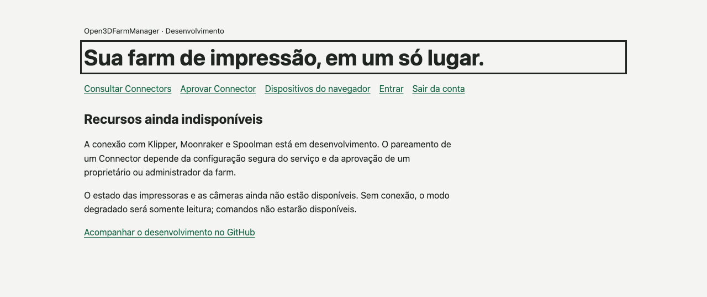
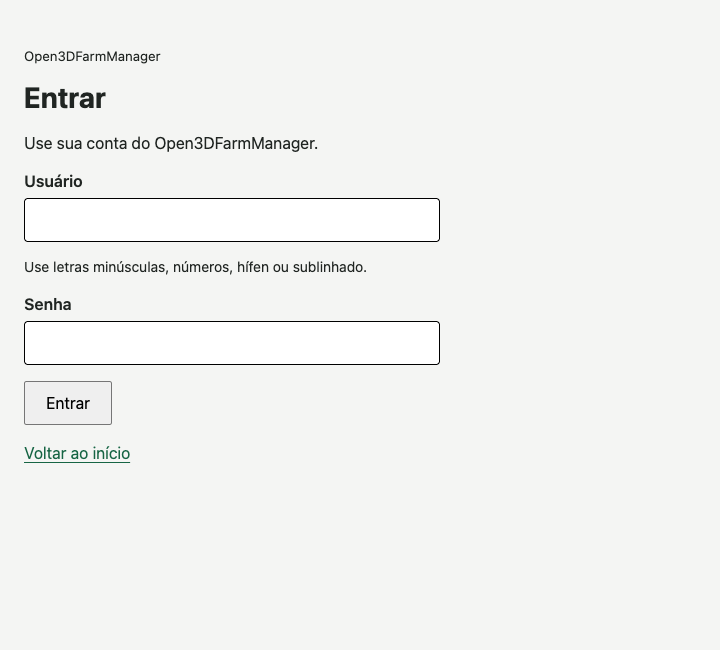
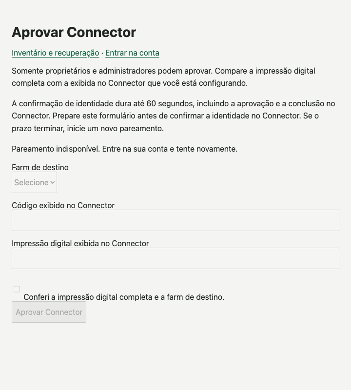
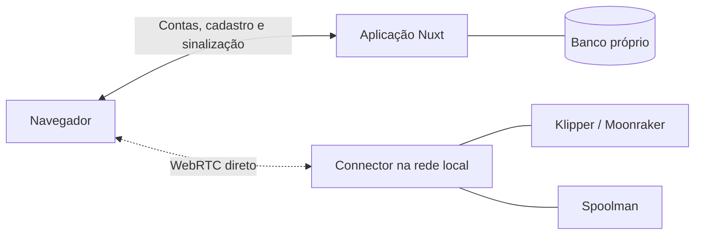

<div align="center">

# Open3DFarmManager

### Sua farm de impressão, em um só lugar.

Um projeto open source para reunir impressoras Klipper/Moonraker, materiais do Spoolman e acesso pelo navegador, com um Connector na sua rede local.

**MIT · Interface em português · Nuxt 4 + TypeScript · Em desenvolvimento**

[Conheça a interface](#conheça-a-interface) · [Execute localmente](#execute-localmente) · [Acompanhe o progresso](docs/PHASE-0.md) · [Contribua](#contribua)

</div>



> **Prévia de desenvolvimento.** A Fase 0 está em andamento. O projeto já tem autenticação, pareamento, inventário, visão da farm, câmera e pausa assinada, atrás de flags e configuração explícita. Nada disso está comprovado em hardware físico (not proven on hardware), e a aceitação integrada ainda não foi concluída. Não é uma versão pronta para operar uma farm em produção.

## Por que este projeto?

Administrar várias impressoras envolve mais do que abrir uma interface por máquina. O Open3DFarmManager está sendo construído para reunir a operação da farm sem tirar do Connector local a responsabilidade de validar o acesso e os comandos.

- **Uma visão da farm no navegador.** Cadastro de impressoras e Connectors separado do estado recebido de cada máquina, para não confundir uma aprovação com uma conexão ativa.
- **Acesso que você pode administrar.** Contas próprias, aprovação de Connectors e dispositivos do navegador, com revogação e recuperação de acesso.
- **Conexão direta por WebRTC e segurança de comandos.** A arquitetura usa o caminho navegador–Connector para estado ao vivo e câmera. Browser commands stay WebRTC-only with no TURN or HTTP fallback; API-originated commands are allowed only with an owner-granted scope, delivered as issuer-signed envelopes, and enforced by the Connector, which refuses unsafe or unauthorized commands with a reason. No automatic retry of uncertain commands, and never command physical printers in automated tests.
- **Começando por Klipper/Moonraker e Spoolman.** A validação passa por simuladores antes de chegar ao hardware.
- **Código aberto para acompanhar e contribuir.** Implementação, testes e registros de aceitação ficam disponíveis no repositório.

## Conheça a interface

Capturas reais do app executado localmente, sem alterações visuais, dados de clientes ou respostas simuladas. As telas abaixo estão sem uma sessão autenticada; o formulário de pareamento permanece desabilitado nesse estado.

<table>
  <tr>
    <th align="left">Acesso à sua conta</th>
    <th align="left">Aprovação do Connector</th>
  </tr>
  <tr>
    <td valign="top"></td>
    <td valign="top"></td>
  </tr>
</table>

Veja a [origem e as instruções para atualizar as capturas](docs/images/README.md).

## O que já existe e o que vem a seguir

| Área                      | Estado atual                                                                                                                                                                                                                          |
| ------------------------- | ------------------------------------------------------------------------------------------------------------------------------------------------------------------------------------------------------------------------------------- |
| Contas e acesso           | Login, sessões próprias, convites, redefinição de senha e autorização por farm implementados; serviços dependem de configuração explícita.                                                                                            |
| Connectors e dispositivos | Pareamento, aprovação, inventário, revogação, provas de identidade e renovação de credenciais implementados. CLI com pareamento e status disponível.                                                                                  |
| Visão da farm             | Página `/farm` atrás da feature flag `farmView`, desligada por padrão: inventário, estado ao vivo por WebRTC direto, idade dos dados e reconexão com recuo. Aceitação integrada com simuladores ainda incompleta.                     |
| Câmera                    | Vídeo RTSP levado ao navegador pelo canal WebRTC autorizado, exibido na visão da farm. Medição de memória nativa e aceitação de ponta a ponta com MediaMTX pendentes.                                                                 |
| Pausa assinada            | Pausa confirmada e assinada pela página da farm, enviada somente por WebRTC ao Connector e liberada apenas quando todas as condições de disponibilidade são atendidas. Sinal de prontidão do Connector após reconexão ainda pendente. |
| Impressoras e simuladores | Identificação Moonraker, várias ferramentas e webcams. Simuladores Klipper com cenários de falha de rede; aceitação do SV06 e do cenário de quatro ferramentas pendente.                                                              |
| Arquivos e histórico      | Páginas de arquivos da impressora e de histórico de trabalhos. Envio completo de arquivos para o Connector e importação de histórico Moonraker ainda em desenvolvimento.                                                              |
| Compatibilidade           | Catálogo por família (Klipper/Moonraker, Creality, Anycubic e Bambu), com capacidades marcadas como simuladas, documentadas ou não comprovadas. Nenhuma delas comprovada em hardware físico (not proven on hardware).                 |
| Spoolman                  | Inventário somente leitura na visão da farm. Integração por farm e registro de uso de filamento por trabalho em desenvolvimento.                                                                                                      |

Nada desta tabela está comprovado em hardware físico (not proven on hardware). Testes locais, integração com fixtures e aceitação com simuladores são evidências diferentes.

**KobraLink (Anycubic Kobra X).** A integração exibe telemetria somente leitura de impressoras Kobra X dentro da interface OpenFarm, sem um segundo painel. O serviço KobraLink é instalado e operado separadamente; veja o [guia de hospedagem](docs/KOBRALINK-SELF-HOSTING.md). O [registro de aceitação RTC](docs/KOBRALINK-RTC-ACCEPTANCE.md) traz a evidência atual e seus limites. A [matriz documental FDM](docs/compatibility/fdm-matrix-final.md) lista 15 identidades candidatas, mas a ordem por recência não está verificada, e a matriz não comprova suporte a firmware ou hardware. Câmera e controles não fazem parte desta integração, e o projeto não é uma versão pronta para produção.

Testes locais, integração com fixtures e aceitação com simuladores são evidências diferentes. O [registro da Fase 0](docs/PHASE-0.md) e o [checkpoint da visão da farm](docs/FARM-VIEW-CHECKPOINT.md) detalham o que cada execução comprova.

## Execute localmente

Você precisa de **Node.js 22.22.3+ na série 22.x ou 24.22.2+ na série 24.x** (`package.json` declara `^22.22.3 || >=24.22.2 <25`) e **npm (incluído no Node.js)**. O `.nvmrc` fixa Node 22.23.5; a CI roda Node 24.22.3 e Node 22.23.5. Docker Compose é necessário para a integração com simuladores, não para abrir a interface inicial.

```sh
git clone https://github.com/bloodf/Open3DFarmManager.git
cd Open3DFarmManager
npm ci --ignore-scripts
npm run dev
```

Abra **http://127.0.0.1:3000**. Você verá a interface de desenvolvimento; esse comando não cria contas, configura banco de dados ou conecta impressoras. Autenticação e integrações começam desabilitadas e exigem configuração própria. A rota `/farm` também depende da feature flag `farmView`.

Para entender a configuração, comece pelos contratos de [sessão](docs/SESSION-PERSISTENCE-CONTRACT.md), [pareamento](docs/PAIRING-CONTRACTS.md) e [autorização da farm](docs/FARM-AUTHORIZATION-CHECKPOINT.md). Mantenha credenciais e configuração privada fora do Git.

### Verificação local

```sh
# Formatação, tipos, testes e builds
npm run check:all

# Testes de interface sobre o app compilado
npx playwright install chromium
npm run test:e2e
```

O segundo fluxo requer o build produzido pelo primeiro. Para reproduzir os jobs e seus pré-requisitos, consulte [CI local](docs/LOCAL-CI.md). Para Klipper, veja o [guia do simulador](infra/sim/README.md). Os testes automatizados não devem enviar comandos a impressoras físicas.

## Rodar no desktop

Para uma máquina sem Docker e sem rede externa, siga o guia completo em [docs/DESKTOP.md](docs/DESKTOP.md). Pré-requisitos: **Node.js 22.22.3+ ou 24.22.2+** (o `.nvmrc` fixa 22.23.5), npm, **Google Chrome** instalado e **PostgreSQL 17+** (`initdb`, `pg_ctl`). Go 1.26+ é opcional e só serve para o helper RTSP.

```sh
npm ci --ignore-scripts          # sem rede: bundle offline, veja docs/desktop-offline-install.md
npm run build
npm run dev                      # interface de desenvolvimento em http://127.0.0.1:3000
npm run desktop:check -- --only app-smoke   # app compilado + Connector + simuladores; abre /farm no Chrome
npm run desktop:check -- --list  # passos disponíveis
```

Os simuladores rodam como processos de teste em loopback; não há um comando persistente para mantê-los de pé. `OPENFARM_SIM=mock` (padrão) e `OPENFARM_PG` (cluster local) mantêm tudo fora do Docker; `OPENFARM_SIM=docker` e `OPENFARM_PG=docker` são opt-in e recusados pelo `desktop:check`. Offline, a Bambu Cloud fica desligada e as câmeras RTSP só funcionam com Go. Detalhes e limites em [docs/DESKTOP.md](docs/DESKTOP.md).

## Como as peças se conectam



O diagrama representa a arquitetura do projeto, incluindo integrações em andamento. O servidor cuida das contas, sinalização e APIs de integração; a validação e aplicação dos comandos fica sempre no Connector, inclusive durante indisponibilidade do servidor. Sem conexão direta pelo navegador, a experiência do navegador é somente leitura.

## Contribua

Quer ajudar a construir a próxima etapa? Consulte as [issues](https://github.com/bloodf/Open3DFarmManager/issues) e o [registro de aceitação](docs/PHASE-0.md). Relatos com passos para reproduzir, melhorias de acessibilidade e testes em simuladores ajudam a avançar o projeto.

1. Trabalhe em uma branch com uma mudança bem delimitada.
2. Preserve os limites de segurança descritos em [segurança de comandos](docs/COMMAND-SECURITY.md): Browser commands stay WebRTC-only with no TURN or HTTP fallback; API-originated commands are allowed only with an owner-granted scope, delivered as issuer-signed envelopes, and enforced by the Connector, which refuses unsafe or unauthorized commands with a reason. No automatic retry of uncertain commands, and never command physical printers in automated tests.
3. Execute `npm run check:all` e descreva os testes feitos e as integrações ainda pendentes.
4. Abra um draft PR. Não inclua segredos, identificadores de contas privadas ou configuração de hospedagem.

## Licença

O código original do projeto usa a [licença MIT](LICENSE). Dependências e fontes de terceiros mantêm suas próprias licenças e avisos; consulte [THIRD_PARTY.md](THIRD_PARTY.md).
