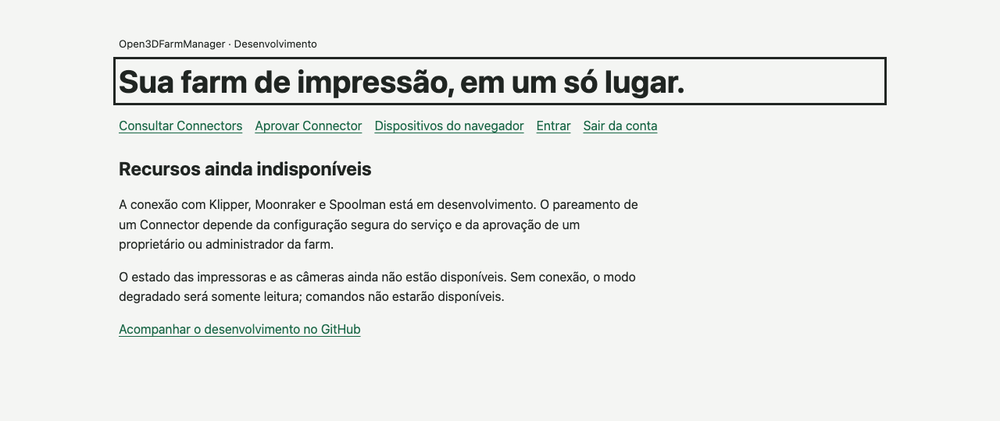
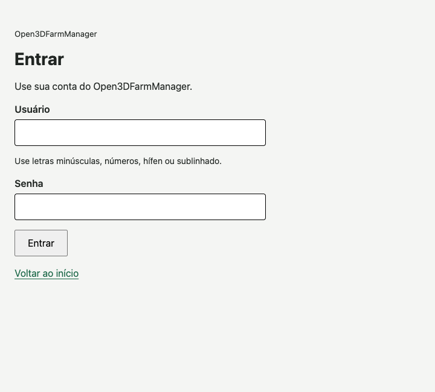
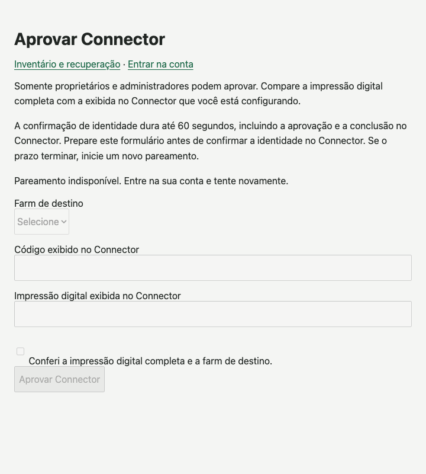
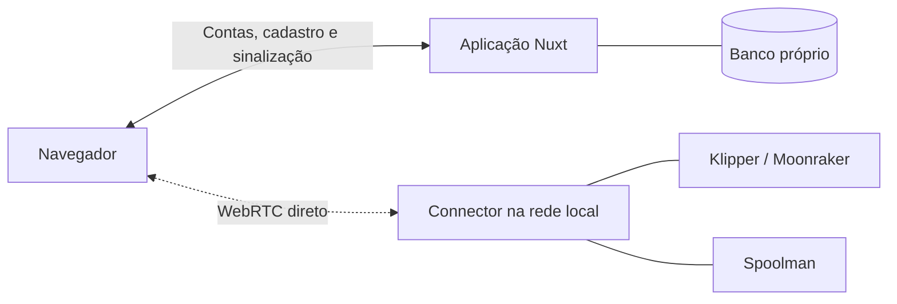

<div align="center">

# Open3DFarmManager

### Sua farm de impressão, em um só lugar.

Um projeto open source para reunir impressoras Klipper/Moonraker, materiais do Spoolman e acesso pelo navegador, com um Connector na sua rede local.

**MIT · Interface em português · Nuxt 4 + TypeScript · Em desenvolvimento**

[Conheça a interface](#conheça-a-interface) · [Execute localmente](#execute-localmente) · [Acompanhe o progresso](docs/PHASE-0.md) · [Contribua](#contribua)

</div>



> **Prévia de desenvolvimento.** A Fase 0 está em andamento. O projeto já tem autenticação, pareamento, inventário e componentes de comunicação direta, mas câmera e pausa de impressão ainda dependem de integração e aceitação. Não é uma versão pronta para operar uma farm em produção.

## Por que este projeto?

Administrar várias impressoras envolve mais do que abrir uma interface por máquina. O Open3DFarmManager está sendo construído para reunir a operação da farm sem tirar do Connector local a responsabilidade de validar o acesso e os comandos.

- **Uma visão da farm no navegador.** Cadastro de impressoras e Connectors separado do estado recebido de cada máquina, para não confundir uma aprovação com uma conexão ativa.
- **Acesso que você pode administrar.** Contas próprias, aprovação de Connectors e dispositivos do navegador, com revogação e recuperação de acesso.
- **Conexão direta por WebRTC.** A arquitetura usa o caminho navegador–Connector para estado ao vivo, câmera e comandos assinados. Sem TURN ou alternativa de comando por HTTP no servidor.
- **Começando por Klipper/Moonraker e Spoolman.** A validação passa por simuladores antes de chegar ao hardware.
- **Código aberto para acompanhar e contribuir.** Implementação, testes e registros de aceitação ficam disponíveis no repositório.

## Conheça a interface

Capturas reais do app executado localmente, sem alterações visuais, dados de clientes ou respostas simuladas. As telas abaixo estão sem uma sessão autenticada; o formulário de pareamento permanece desabilitado nesse estado.

<table>
  <tr>
    <th align="left">Acesso à sua conta</th>
    <th align="left">Aprovação do Connector</th>
  </tr>
  <tr>
    <td valign="top"></td>
    <td valign="top"></td>
  </tr>
</table>

Veja a [origem e as instruções para atualizar as capturas](docs/images/README.md).

## O que já existe e o que vem a seguir

| Área                      | Estado atual                                                                                                                                                          |
| ------------------------- | --------------------------------------------------------------------------------------------------------------------------------------------------------------------- |
| Contas e acesso           | Login, sessões próprias e autorização por farm implementados; serviços dependem de configuração explícita.                                                            |
| Connectors e dispositivos | Pareamento, inventário, aprovação, revogação e provas de identidade implementados.                                                                                    |
| Visão da farm             | Página somente leitura sob feature flag, com inventário e estado autenticado. Há evidência integrada com HTTPS, PostgreSQL, RTC e uma fixture de protocolo Moonraker. |
| Spoolman                  | Cliente e contratos HTTP com testes; a experiência integrada de materiais ainda está em desenvolvimento.                                                              |
| Pausa assinada            | Transporte, autoridade, relay e emissão de capacidade implementados em etapas; o controle no produto continua desabilitado.                                           |
| Câmera e simulador        | Existem testes e provas parciais. Vídeo em movimento e pausa genuína no simulador ainda têm critérios de aceitação pendentes.                                         |

Testes locais, integração com fixtures e aceitação com simuladores são evidências diferentes. O [registro da Fase 0](docs/PHASE-0.md) e o [checkpoint da visão da farm](docs/FARM-VIEW-CHECKPOINT.md) detalham o que cada execução comprova.

## Execute localmente

Você precisa de **Node.js 24.15+ na série 24.x** e **Bun 1.4.2**. Os fluxos de CI usam Node 24.20.0. Docker Compose é necessário para a integração com simuladores, não para abrir a interface inicial.

```sh
git clone https://github.com/bloodf/Open3DFarmManager.git
cd Open3DFarmManager
bun install --frozen-lockfile --ignore-scripts
bun run dev
```

Abra **http://127.0.0.1:3000**. Você verá a interface de desenvolvimento; esse comando não cria contas, configura banco de dados ou conecta impressoras. Autenticação e integrações começam desabilitadas e exigem configuração própria. A rota `/farm` também depende da feature flag `farmView`.

Para entender a configuração, comece pelos contratos de [sessão](docs/SESSION-PERSISTENCE-CONTRACT.md), [pareamento](docs/PAIRING-CONTRACTS.md) e [autorização da farm](docs/FARM-AUTHORIZATION-CHECKPOINT.md). Mantenha credenciais e configuração privada fora do Git.

### Verificação local

```sh
# Formatação, tipos, testes e builds
bun run check:all

# Testes de interface sobre o app compilado
bunx playwright install chromium
bun run test:e2e
```

O segundo fluxo requer o build produzido pelo primeiro. Para reproduzir os jobs e seus pré-requisitos, consulte [CI local](docs/LOCAL-CI.md). Para Klipper, veja o [guia do simulador](infra/sim/README.md). Os testes automatizados não devem enviar comandos a impressoras físicas.

## Como as peças se conectam



O diagrama representa a arquitetura do projeto, incluindo integrações em andamento. O servidor cuida das contas e da sinalização; a validação dos comandos fica no Connector, inclusive durante indisponibilidade do servidor. Sem conexão direta, a experiência é somente leitura.

## Contribua

Quer ajudar a construir a próxima etapa? Consulte as [issues](https://github.com/bloodf/Open3DFarmManager/issues) e o [registro de aceitação](docs/PHASE-0.md). Relatos com passos para reproduzir, melhorias de acessibilidade e testes em simuladores ajudam a avançar o projeto.

1. Trabalhe em uma branch com uma mudança bem delimitada.
2. Preserve os limites de segurança descritos em [segurança de comandos](docs/COMMAND-SECURITY.md).
3. Execute `bun run check:all` e descreva os testes feitos e as integrações ainda pendentes.
4. Abra um draft PR. Não inclua segredos, identificadores de contas privadas ou configuração de hospedagem.

## Licença

O código original do projeto usa a [licença MIT](LICENSE). Dependências e fontes de terceiros mantêm suas próprias licenças e avisos; consulte [THIRD_PARTY.md](THIRD_PARTY.md).
