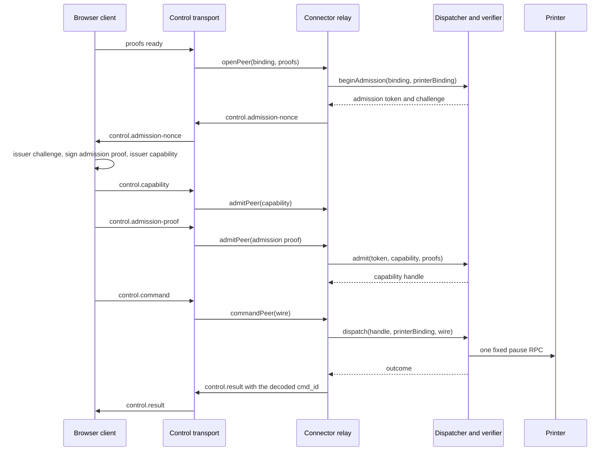

# Pause command relay and browser command client

Status: `em revisão`
Slice: library only, no runtime wiring, no UI.
Base source: `084ffef380a9fb12b85d1e3c3ad591951a821c5d`
Composed slice: `4fd6a7f6aa1d663a4141864455237f9a28bc4c36`
Branch: `t3/harden-pause-command-relay`

## What this slice is

Two new library modules compose the existing pause pieces into one authenticated
command path, without touching any existing file.

The Connector side owns the dispatcher, and through it the capability verifier.
The browser side owns the admission exchange and the single signed command.
Neither module talks to Moonraker, to the issuer or to the server, and neither
one adds a frame type, a schema or a table.

| File                                                    | Change                                                                                                                     |
| ------------------------------------------------------- | -------------------------------------------------------------------------------------------------------------------------- |
| `packages/connector/src/control/pause-command-relay.ts` | new. `createPauseCommandRelay` owns one `createPauseDispatcher` and exposes the peer lifecycle over the existing transport |
| `apps/farm/app/utils/webrtc/pause-command-client.ts`    | new. `createPauseCommandClient` owns the browser admission exchange and the single signed command                          |
| `tests/node/pause-command-relay.test.ts`                | new. focused tests for the relay, including the real control transport                                                     |
| `tests/node/pause-command-client.test.ts`               | new. focused tests for the browser client                                                                                  |

No config, runtime, UI, protocol, index, signalling, dispatcher, verifier,
driver or journal file was modified. The issuer keyring, the local printer
mapping, the journal, the driver and the clock are injected by the caller.

## The composition



The capability handle returned by `dispatcher.admit` and the printer binding
used by `observe`, the driver and `dispatch` are different objects. The relay
keeps them apart: the handle is the admitted authority, the binding is the
local provisioned mapping. `beginAdmission` returns the admission context
(token plus challenge), not a capability.

## Rules the relay enforces

**One dispatcher, one verifier.** The relay creates the dispatcher and nobody
else can reach it. There is no injected verifier handle and no injected
admission callback.

**Local binding only.** The printer binding comes from the injected
`bindingFor` resolver. The peer never supplies an origin, a URL or a printer
key. A peer whose assignment is not mapped locally is refused before any frame
is sent.

**Local mapping agreement.** The relay refuses a peer whose local mapping
disagrees with the control binding on farm, agent or assignment.

**An existing transport cannot be replaced.** Opening the same transport id
is refused without closing its current peer or changing its admission nonce.
The caller supplies the binding and proofs after mutual transport authentication.
The relay parses the proof envelopes and matches their scope when opening;
its capability verifier checks the signatures during admission. Parsing alone
is not authentication.

**Admission is single use and incremental.** The two admission phases arrive as
two frames. The relay buffers either half and consumes the verifier token only
when the exact capability and admission proof pair is complete. A half
delivered pair never consumes the token: the admission deadline ends the wait.
The deadline is the policy bound of eight seconds and it is never reset by a
late half.

**A command waits for its admission.** The transport delivers the command
right after the admission phases, while the admission crypto is still running.
The relay holds the command until the admission settles, so an in-flight
admission never turns into a false `rejected`.

**One command per peer.** The command slot is reserved before any await, so a
reentrant command replays the first promise. The second command of a peer
replays the first outcome and is never dispatched twice.

**Exact correlation.** The result frame carries the `cmd_id` decoded from the
command wire, never a generated id. A wire that cannot be decoded produces no
result frame at all.

**Closing seals.** `closePeer` aborts the in-flight dispatch, revokes the
capability and closes the peer. After that, no result frame is ever sent. A
dispatch that was already permitted settles as `outcome-unknown` and the
journal keeps the durable unknown record. An admission that succeeds after the
peer was sealed revokes its handle and never resurrects the peer.

**Real deadlines, no pretended cancellation.** Every bound is a real timer on a
monotonic clock: the peer deadline at the admission lease, the capability
deadline after a successful admission. A broken or rewound monotonic clock is
never trusted for a deadline. No bound is implemented as a race that pretends
to cancel work that keeps running.

**Bounded state.** The peer map, the concurrent commands and the retained work
are bounded. A peer, a command or a work item beyond its bound is refused,
never queued. The retained work stays retained until it actually settles.

**Inert by default.** `sendPhase` and `sendResult` are optional. Without them
the relay cannot deliver the admission nonce, refuses the peer and sends
nothing. Constructing a relay never enables a command anywhere.

**Strict transport contract.** A transport callback must return a boolean. A
throwing callback, a non boolean result or a thenable result is a transport
fault: the peer is closed and the outcome stays local. The caller of
`commandPeer` always receives an outcome and never a rejected promise.

## Rules the browser client enforces

**Existing key and schema.** The client signs with the existing enrolled
nonextractable P-256 key, uses `signCommandV2` and the existing capability and
admission proof schemas. No new schema, no new frame.

**Issued capability fields.** The command is built from the fields of the
capability the issuer actually issued, and the command lifetime is bounded by
the capability expiry and by the existing five second command bound.

**Local scope check.** The challenge and the capability are checked against the
local control binding, including the control binding hash. A capability
outside the scope never reaches the transport. The binding is snapshotted once
and never read again.

**One operation per session.** `pause` reserves the single operation before
any await. A second `pause` is refused without touching the transport, also
when it arrives while the first one is still signing.

**Exact correlation.** Only a result whose `command_id` equals the signed
command id settles the command. Any other result is ignored.

**Unknown is never a clean rejection.** A command that was handed to the
transport, or whose hand over was refused or faulted, settles as
`outcome-unknown`. Only a command that never reached the transport settles as
`rejected`.

**Abort seals.** After `abort` no phase and no command is sent again. A
command that was already sent settles as `outcome-unknown`, because the client
cannot know whether the printer paused. A command that was never sent settles
as `rejected`.

**Real deadlines.** The session ends at the smaller of the local bound and the
transport deadline. The admission ends after eight seconds, the command result
after five. A dropped result settles as `outcome-unknown`.

**Retained work.** Every issuer call and every command stays retained until it
actually settles. `settled` resolves when the client is terminal, that is
aborted or settled by its command, and every retained task actually settled.
While the client can still accept a phase or a command it never resolves.
Nothing is cancelled and nothing is faked.

## Deviations from the proposal

The proposal was read as a proposal, not as authority. These points follow the
actual source.

| Proposal                                         | Source of truth                                                                                                     |
| ------------------------------------------------ | ------------------------------------------------------------------------------------------------------------------- |
| `admit` callback and standalone verifier handles | rejected. `createPauseDispatcher` owns the verifier, so the relay owns the dispatcher and injects only the keyring  |
| capability handle treated as the printer binding | rejected. `dispatcher.admit` returns an opaque capability handle, `observe` and `dispatch` take the printer binding |
| `advancePeer` and a standalone `revoke`          | rejected. A peer is replaced by opening a new one, and closing a peer already revokes its capability                |
| result timeout knob                              | rejected. The dispatcher default is the hard maximum of five seconds and the relay does not widen it                |
| `revoke` after a failed admission                | changed. The peer stays open so a command already on the wire still receives an honest `rejected`                   |
| abort resolves a pending command as `rejected`   | changed. A command already sent settles as `outcome-unknown`                                                        |

## Review disposition

The independent review of `4fd6a7f` reported thirteen findings. Each one was
verified against the source and the disposition is recorded here.

| Finding | Disposition                                                                                                                                                               |
| ------- | ------------------------------------------------------------------------------------------------------------------------------------------------------------------------- |
| D1      | fixed. The client reserves the single operation before any await. A second `pause` is refused without a send.                                                             |
| D2      | fixed. A refused or faulted hand over settles as `outcome-unknown`, never as `rejected`.                                                                                  |
| D3      | fixed. Every transport call goes through a strict synchronous guard. A fault closes the peer or keeps the result local, and the caller never receives a rejected promise. |
| D4      | fixed. Real monotonic timers now expire the peer, the admission and the result. The peer map and the retained work are bounded.                                           |
| D5      | fixed. The relay admits incrementally and consumes the verifier token only with the exact pair.                                                                           |
| D6      | fixed. A late admission revokes its handle and never resurrects a sealed peer.                                                                                            |
| D7      | fixed. A rejected admission resolves the gate with a reason instead of leaving it pending.                                                                                |
| D8      | fixed. The admission bound comes from the shared policy constant and every deadline uses the monotonic clock.                                                             |
| D9      | fixed. The admission failure reason is reported in `diagnostics().lastReason`.                                                                                            |
| D10     | fixed. A throwing observer never breaks the settlement of the command.                                                                                                    |
| D11     | fixed. `settled` has an exact meaning on both sides and never resolves while work can still arrive.                                                                       |
| D12     | fixed. A duplicate transport is refused without replacing its live peer.                                                                                                  |
| D13     | fixed. The declared base source is the reviewed parent.                                                                                                                   |

The review also warned against copying its own claim that a timer can never
fire. The timers are armed with a real `setTimeout` and the focused tests
advance them, so the expiry path is proven, not assumed.

## Evidence

```text
node --test --test-timeout=20000 tests/node/pause-command-relay.test.ts tests/node/pause-command-client.test.ts
tests 36, pass 36, fail 0

tsc --noEmit (strict, exactOptionalPropertyTypes, noUncheckedIndexedAccess)
on the repository: no diagnostics

tsc --noEmit with the same flags on apps/farm/app/utils/webrtc/pause-command-client.ts
no diagnostics
```

The relay tests use real P-256 and Ed25519 keys, a real SQLite command journal
and a local driver double. The last relay test runs both sides of the real
`PauseControlSession` in memory, with genuine keys and the real journal, and
carries the two admission frames, the command and the result. The browser
tests use a real nonextractable P-256 key, a real issuer signature and a local
transport double. No printer, no Moonraker, no server, no browser, no container
and no database server is touched.

The evidence of the composed slice `4fd6a7f` is preserved in the history of
this file: seventeen synthetic tests over local transport doubles. The run
above replaces it and adds the transport level integration, the real deadlines
and the bounded state.

## Not proven here

- `bun run check:all` was not run. The heavy slot belongs to the coordinator
  and the release gate is not open for this slice.
- The relay and the client are not wired to the runtime, to the signalling
  clients or to the UI. Nothing in the running product changed.
- The runtime still loses the printer binding handle, so the connector cannot
  yet answer `bindingFor` for a live assignment.
- The browser still has no issuer adapter. The HTTP endpoints exist
  (`/api/pause-authority/challenges` and `/api/pause-authority/capabilities`),
  but the adapter that calls them with the session cookie is not part of this
  slice.
- The browser client and the control transport must share the monotonic time
  origin, because the transport deadline is expressed in it. A deadline of
  another clock realm is ignored by the client and the transport stays the
  authority of the session lifetime.
- No real RTC session, no real Moonraker and no simulator run proves this
  composition. The in memory transport test proves the frame sequence, not the
  network path.

## Follow-up lifecycle checks

The client refuses a second proofs-ready context and permanently ends failed
admission attempts. Expiration also stops an issuer that ignores abort from
publishing late admission frames. Every rejected pause operation becomes
terminal while actual pending issuer work remains retained until it settles.
The relay validates bounded admission encodings before retaining either half,
refuses duplicate live transport IDs, and handles invalid or throwing wall
clocks without sending an admission nonce. The legacy `unsentResults` counter
counts unconfirmed transport handoffs, not evidence that a frame was unsent.

These changes have focused local regression coverage. Full repository checks
and actual RTC, Moonraker and simulator composition remain separate gates.
