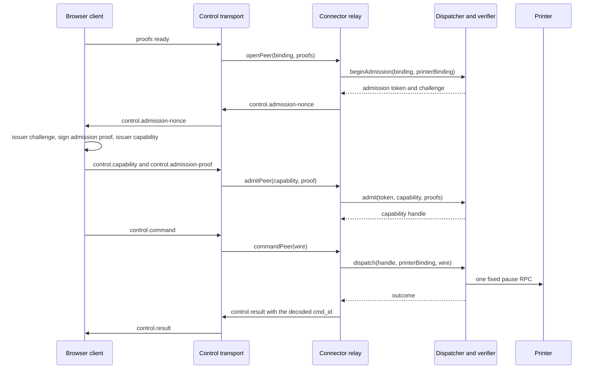

# Pause command relay and browser command client

Status: `em revisão`
Slice: library only, no runtime wiring, no UI.
Base source: `f57cb2059ca066ad0b8d3f0498435368cef92ae2`
Branch: `t3/pause-command-relay`

## What this slice is

Two new library modules compose the existing pause pieces into one authenticated
command path, without touching any existing file.

The Connector side owns the dispatcher, and through it the capability verifier.
The browser side owns the admission exchange and the single signed command.
Neither module talks to Moonraker, to the issuer or to the server, and neither
one adds a frame type, a schema or a table.

| File                                                    | Change                                                                                                                     |
| ------------------------------------------------------- | -------------------------------------------------------------------------------------------------------------------------- |
| `packages/connector/src/control/pause-command-relay.ts` | new. `createPauseCommandRelay` owns one `createPauseDispatcher` and exposes the peer lifecycle over the existing transport |
| `apps/farm/app/utils/webrtc/pause-command-client.ts`    | new. `createPauseCommandClient` owns the browser admission exchange and the single signed command                          |
| `tests/node/pause-command-relay.test.ts`                | new. focused tests for the relay                                                                                           |
| `tests/node/pause-command-client.test.ts`               | new. focused tests for the browser client                                                                                  |

No config, runtime, UI, protocol, index, signalling, dispatcher, verifier,
driver or journal file was modified. The issuer keyring, the local printer
mapping, the journal, the driver and the clock are injected by the caller.

## The composition



The capability handle returned by `dispatcher.admit` and the printer binding
used by `observe`, the driver and `dispatch` are different objects. The relay
keeps them apart: the handle is the admitted authority, the binding is the
local provisioned mapping. `beginAdmission` returns the admission context
(token plus challenge), not a capability.

## Rules the relay enforces

**One dispatcher, one verifier.** The relay creates the dispatcher and nobody
else can reach it. There is no injected verifier handle and no injected
admission callback.

**Local binding only.** The printer binding comes from the injected
`bindingFor` resolver. The peer never supplies an origin, a URL or a printer
key. A peer whose assignment is not mapped locally is refused before any frame
is sent.

**Local mapping agreement.** The relay refuses a peer whose local mapping
disagrees with the control binding on farm, agent or assignment.

**Admission is single use.** The relay admits once per peer. A repeated
`admitPeer` returns the first outcome instead of consuming the token twice.

**A command waits for its admission.** The transport delivers the command
right after the admission phases, while the admission crypto is still running.
The relay holds the command until the admission settles, so an in-flight
admission never turns into a false `rejected`.

**One command per peer.** The second command of a peer replays the first
outcome. It is never dispatched twice.

**Exact correlation.** The result frame carries the `cmd_id` decoded from the
command wire, never a generated id. A wire that cannot be decoded produces no
result frame at all.

**Closing seals.** `closePeer` aborts the in-flight dispatch, revokes the
capability and closes the peer. After that, no result frame is ever sent. A
dispatch that was already permitted settles as `outcome-unknown` and the
journal keeps the durable unknown record.

**Inert by default.** `sendPhase` and `sendResult` are optional. Without them
the relay cannot deliver the admission nonce, refuses the peer and sends
nothing. Constructing a relay never enables a command anywhere.

## Rules the browser client enforces

**Existing key and schema.** The client signs with the existing enrolled
nonextractable P-256 key, uses `signCommandV2` and the existing capability and
admission proof schemas. No new schema, no new frame.

**Issued capability fields.** The command is built from the fields of the
capability the issuer actually issued, and the command lifetime is bounded by
the capability expiry and by the existing five second command bound.

**Local scope check.** The challenge and the capability are checked against
the local control binding, including the control binding hash. A capability
outside the scope never reaches the transport.

**One command.** The command is reserved before the send. A second `pause()`
is rejected and never resends.

**Exact correlation.** Only a result whose `command_id` equals the signed
command id settles the command. Any other result is ignored.

**Abort seals.** After `abort` no phase and no command is sent again. A
command that was already sent settles as `outcome-unknown`, because the client
cannot know whether the printer paused. A command that was never sent settles
as `rejected`.

**Retained work.** Every issuer call and every command stays retained until it
actually settles. `settled` resolves only then. Nothing is cancelled and
nothing is faked.

## Deviations from the proposal

The proposal was read as a proposal, not as authority. These points follow the
actual source.

| Proposal                                         | Source of truth                                                                                                     |
| ------------------------------------------------ | ------------------------------------------------------------------------------------------------------------------- |
| `admit` callback and standalone verifier handles | rejected. `createPauseDispatcher` owns the verifier, so the relay owns the dispatcher and injects only the keyring  |
| capability handle treated as the printer binding | rejected. `dispatcher.admit` returns an opaque capability handle, `observe` and `dispatch` take the printer binding |
| `advancePeer` and a standalone `revoke`          | rejected. A peer is replaced by opening a new one, and closing a peer already revokes its capability                |
| result timeout knob                              | rejected. The dispatcher default is the hard maximum of five seconds and the relay does not widen it                |
| `revoke` after a failed admission                | changed. The peer stays open so a command already on the wire still receives an honest `rejected`                   |
| abort resolves a pending command as `rejected`   | changed. A command already sent settles as `outcome-unknown`                                                        |

## Evidence

```text
node --test tests/node/pause-command-relay.test.ts tests/node/pause-command-client.test.ts
tests 17, pass 17, fail 0

tsc --noEmit (strict, exactOptionalPropertyTypes, noUncheckedIndexedAccess)
on the four new files: no diagnostics

prettier --check on the four new files: clean
```

The relay tests use real P-256 and Ed25519 keys, a real SQLite command journal
and a local driver double. The browser tests use a real nonextractable P-256
key, a real issuer signature and a local transport double. No printer, no
Moonraker, no server, no browser, no container and no database server is
touched.

## Not proven here

- `bun run check:all` was not run. The heavy slot belongs to the dispatcher
  fixture worker and the coordinator owns the release gate.
- `bun run --cwd apps/farm typecheck` was not run. The Nuxt project references
  were not prepared in this worktree.
- The relay and the client are not wired to the runtime, to the signalling
  clients or to the UI. Nothing in the running product changed.
- The runtime still loses the printer binding handle, so the connector cannot
  yet answer `bindingFor` for a live assignment.
- The browser still has no issuer adapter. The HTTP endpoints exist
  (`/api/pause-authority/challenges` and `/api/pause-authority/capabilities`),
  but the adapter that calls them with the session cookie is not part of this
  slice.
- No real RTC session, no real Moonraker and no simulator run proves this
  composition. The earlier real RTC result proves the transport, not this
  relay.
