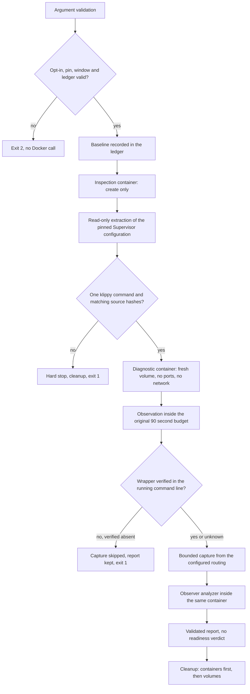

# Simulator identification diagnostic runner

`scripts/simulator-identify-diagnostic.mjs` is a maintained, opt-in, bounded
runner that observes one identification session inside the pinned synthetic
simulator. It exists to answer a question the current collector cannot: what
did the Klipper identification session observe while the serial queue was still
alive.

The runner is an instrument, not a gate. It never reports readiness, never
retries a failed run, never promotes a result to a passing check and never
changes the 90-second readiness budget, the pinned image, the emulator, the
firmware, the Supervisor restart policy or the Compose limits.

The runner reuses `infra/sim/experiments/serial_diagnostic.py` unchanged. The
observer owns the classification; the runner only validates what the observer
produced and refuses to emit anything it cannot verify.

## Status

Source, focused tests and this document are prepared. **No container, network,
serial device or simulator was created by this task**, so no observation result
exists yet. Every statement below describes the implemented behaviour of the
source, not a measurement.

| Property           | Value                                                                                                                    |
| ------------------ | ------------------------------------------------------------------------------------------------------------------------ |
| Pinned image       | `ghcr.io/mainsail-crew/virtual-klipper-printer@sha256:c2ab1d20a3f6d9dda182bf69a078c5f37a066a44f1f34ffea48d49ddf7bbce47`  |
| Platform           | `linux/amd64`                                                                                                            |
| Observer file      | `infra/sim/experiments/serial_diagnostic.py`, SHA-256 `791805817b88d1f365a49a2c968c028026a95d8b6fb500f2956af833e05033fb` |
| Observation window | at most 90 000 ms, the original readiness budget                                                                         |
| Readiness verdict  | always `not-evaluated`                                                                                                   |

The Docker binary is resolved from `PATH` as `docker`. The runner never
installs anything and never resolves a binary from a repository path, so a
host whose `PATH` points at another `docker` executes that binary. The
programmatic seam accepts a different binary name for a controlled harness.

## RPC parser correction and Cortex preflight

The second Linux diagnostic at head `9d9cc234857c47c7e2fa860cfac24afcc76acea6`
completed discovery, then failed before observation with
`unsupported supervisor configuration key at line 12`. No live observation
container or session started. The original failure evidence must be retained.
The parser now accepts only `supervisor.rpcinterface_factory` in
`[rpcinterface:supervisor]` as an exception to its ordinary key grammar.
Its value and source text are preserved; no factory is executed by the parser.
Other dotted keys and this field in other sections remain rejected.

The complete 2,111-byte upstream configuration at
[commit e272bcd](https://github.com/mainsail-crew/virtual-klipper-printer/blob/e272bcd1060dad6cee1598d6debdaa5d5afae3c7/config/supervisord.conf)
was inspected statically. Its SHA256 is
`33d472433a78f681fc6b8b05c23d7f734caa0b19240fdd131cc867be6f8b3008`,
matching the separately reported image extraction. Keep the GPL file outside
this MIT repository. All section headers, ordinary keys, spacing, blank lines,
inline value comments and the RPC key fit the corrected parser grammar.
There are no continuation lines. Only the Klippy command is tokenized by the
transformer; commands in the other three program sections stay unchanged.

The Klippy interpreter `/home/printer/python-env/bin/python` is now an exact
allowlisted alias. The [pinned Dockerfile](https://github.com/mainsail-crew/virtual-klipper-printer/blob/e272bcd1060dad6cee1598d6debdaa5d5afae3c7/Dockerfile)
declares Python 3.12 builder and runner base tags, creates `/build/python-env`
with `virtualenv -p python3`, then copies it into `/home/printer/python-env`.
The [pinned relocation script](https://github.com/mainsail-crew/virtual-klipper-printer/blob/e272bcd1060dad6cee1598d6debdaa5d5afae3c7/scripts/fix_venvs.sh)
repairs shebang paths. This is a source build contract, not proof of the binary
or symlink in the digest-pinned image. Before observation, obtain separately
authorized read-only image evidence of that alias's target and Python major
version. Arbitrary `python`, Python 2, relative paths and other virtualenv
paths remain rejected. Runtime CWD, MCU state, readiness and identification
remain unknown.

On Cortex, with the parent's authorization and resource ledger, perform these
cheap checks before any Docker or simulator attempt:

1. Fetch the exact upstream file above into bounded external GPL evidence and
   verify its SHA256 against the image extraction. Abort on any mismatch.
2. RED: export the runner from base `9d9cc234857c47c7e2fa860cfac24afcc76acea6`
   into an external `.mjs` file. Import it without invoking `runDiagnostic`.
   Pass the entire unmodified config to `parseSupervisorConfig`; assert phase
   `parse` and exact message
   `unsupported supervisor configuration key at line 12`.
3. GREEN: import the candidate runner without invoking `runDiagnostic` and
   parse the same entire original config. Assert the section sequence is
   `supervisord`, `rpcinterface:supervisor`, `supervisorctl`,
   `unix_http_server`, `program:simulavr`, `program:klipper`,
   `program:moonraker`, `program:webcamd`. Assert the RPC field's value remains
   `supervisor.rpcinterface:make_main_rpcinterface` and the Klippy command
   matches the original bytes. No normalized or edited config is acceptable.
4. RED on base `fff9595d1bc689b97158fc057d77aa8c18337a8a`: call
   `transformSupervisorConfig` on that original config with
   `OBSERVER_MOUNT_PATH`. Assert phase `transform` and exact message
   `unsupported interpreter invocation in klippy command`.
5. GREEN on the candidate: execute the original-config transform preflight
   below. Stop on any assertion failure. This checks source transformation
   only and never invokes Docker or the observer.
6. Run the focused Node suite on the candidate. Preserve the prior 80 cases
   and two RPC regressions; the two additional cases cover the exact virtualenv
   invocation and rejected interpreter paths. Run required full checks and
   obtain fresh exact-head review before publication. Obtain actual-image
   Python3 alias proof before any observation.

Set `RUNNER` to the absolute candidate script path and `CONFIG` to the external
unmodified image configuration. On the authorized Cortex host, run:

```sh
node --input-type=module - "$RUNNER" "$CONFIG" <<'JS'
import assert from 'node:assert/strict'
import { createHash } from 'node:crypto'
import { readFileSync } from 'node:fs'
import { pathToFileURL } from 'node:url'
const runner = await import(pathToFileURL(process.argv[2]).href)
const bytes = readFileSync(process.argv[3])
assert.equal(createHash('sha256').update(bytes).digest('hex'),
  '33d472433a78f681fc6b8b05c23d7f734caa0b19240fdd131cc867be6f8b3008')
const source = bytes.toString('utf8')
const parsed = runner.parseSupervisorConfig(source)
assert.deepEqual(parsed.sections.map(s => s.type + (s.name ? ':' + s.name : '')),
  ['supervisord', 'rpcinterface:supervisor', 'supervisorctl', 'unix_http_server',
   'program:simulavr', 'program:klipper', 'program:moonraker', 'program:webcamd'])
const { command } = runner.findKlipperProgram(parsed)
const tokens = runner.parseSupervisorCommand(command.value).tokens
assert.equal(tokens[0], '/home/printer/python-env/bin/python')
assert.equal(tokens[1], '/home/printer/klipper/klippy/klippy.py')
const result = runner.transformSupervisorConfig(source, {
  observerPath: runner.OBSERVER_MOUNT_PATH,
})
const expected = parsed.lines.slice()
const original = expected[command.line]
expected[command.line] = original.slice(0, original.indexOf('=') + 1) +
  [tokens[0], runner.OBSERVER_MOUNT_PATH, 'observe', '/home/printer/klipper',
   '--', ...tokens.slice(2)].join(' ')
assert.equal(result.text, expected.join('\n'))
assert.equal(result.delta.interpreter, tokens[0])
assert.equal(result.delta.klipperRoot, '/home/printer/klipper')
assert.deepEqual(result.delta.klippyArguments, tokens.slice(2))
assert.equal(result.delta.otherPrograms.length, 3)
console.log('Original-config transform preflight PASS; runtime remains unproved')
JS
```

The RED/GREEN steps above are instructions, not executed results. This Mac
source-only correction runs no tests, builds, installations or Docker commands.
Remove disposable exported modules after verification; retain only bounded GPL
source and diagnostic evidence outside the repository.

## Invocation

```sh
node scripts/simulator-identify-diagnostic.mjs \
  --opt-in=synthetic-identification-diagnostic \
  --ledger-dir=/absolute/path/outside/the/repository
```

| Argument                | Required | Meaning                                                    |
| ----------------------- | -------- | ---------------------------------------------------------- |
| `--opt-in=<token>`      | yes      | must equal `synthetic-identification-diagnostic`           |
| `--ledger-dir=<path>`   | no       | external evidence directory, refused inside the repository |
| `--image=<reference>`   | no       | must equal the reviewed pinned amd64 reference             |
| `--platform=<name>`     | no       | must equal `linux/amd64`                                   |
| `--observation-ms=<n>`  | no       | at most 90 000                                             |
| `--compose-file=<path>` | no       | Compose file whose pin is verified                         |
| `--observer=<path>`     | no       | observer file whose hash is verified                       |

Any other argument is refused. Arguments that name an endpoint, a host, a port,
a URL, a socket, a serial device, a printer or a network are refused before
anything runs. The process exit code is `0` for a completed diagnostic, `2` for
a refused invocation and `1` for a failed run.

The image, the platform and the observation window are validated in one place,
`assertRunSettings`, and both the command line and the programmatic entry point
call it. A programmatic caller cannot create a container from an unpinned image
or observe longer than the readiness budget.

The runner writes one JSON object to standard output. A failed run writes the
report it managed to build to standard output first and then one JSON object
to standard error with the primary failure, the phase and the cleanup
failures.

## Safety model



Container constraints, all enforced by `assertContainerIsolation`:

| Constraint            | Value                                                                            |
| --------------------- | -------------------------------------------------------------------------------- |
| Network               | `--network none`, no published port                                              |
| Privileges            | no `--privileged`, no `--device`, `no-new-privileges:true`                       |
| Image                 | `--pull never`, the reviewed pinned digest only                                  |
| CPU, memory, PIDs     | 2 CPUs, 1 GiB, 256 PIDs, as the current Compose service                          |
| Mounts                | the observer and the transformed configuration read-only, one fresh named volume |
| Temporary directories | `/tmp` and `printer_data/comms` with `noexec`                                    |

The forbidden options are refused in every spelling the runner could produce,
including the `--option=value` form, so a regression cannot widen the
isolation by changing the spelling of an argument.

The runner creates only resources that carry its own label
`com.open3dfarmmanager.identify-diagnostic=<run id>`. A resource is removed
only after its labels are verified. A label mismatch is a refusal, never a
deletion. There is no prune, no broad filter and no process kill.

Cleanup removes the containers before the volumes. A volume that is still
mounted by a container cannot be removed, so the reverse order leaks a named
volume on every run. A removal that fails is retried once, and the resources
that were already removed are never inspected again.

## Configuration adaptation

The Supervisor configuration is extracted read-only from the pinned image. The
image entrypoint metadata yields the entrypoint candidates, the first candidate
that is a readable text file yields the entrypoint script, the script yields
the Supervisor configuration path, and the configuration is copied out of the
inspection container. Nothing is guessed: a candidate that is missing, binary
or larger than the permitted size is rejected and the discovery continues with
the next candidate, and a run that finds no usable candidate stops and names
every rejected candidate.

The transformation changes exactly one value, the `command` of the
`[program:klipper]` section:

```text
command=python3 /home/printer/klipper/klippy/klippy.py
->
command=python3 /opt/o3dfm/serial_diagnostic.py observe /home/printer/klipper --
```

The rules are strict:

1. Exactly one `[program:klipper]` section and exactly one `command` in it.
2. The interpreter and its flags are preserved verbatim.
3. The Klippy arguments after the script path are preserved verbatim.
4. The Klipper root is derived from the script path, never invented.
5. The restart and retry policy, the priorities and every other program stay
   byte-identical; the transformation re-parses the result and refuses to
   continue when any of them changed.
6. Shell metacharacters, quoting characters and whitespace inside an argument
   are refused. The command is never evaluated as a shell string.

The extracted configuration belongs to the upstream image and stays under its
GPL-3.0 licence. It is written to the external ledger with a notice file and
is never committed.

## Child stderr routing

The observer writes to the child's stderr. Where that stderr lands is decided
by Supervisor, and the runner derives the answer from the extracted
configuration instead of assuming it.

| Configuration                                    | Capture source                               |
| ------------------------------------------------ | -------------------------------------------- |
| `redirect_stderr=true` with `stdout_logfile`     | that file inside the container               |
| `redirect_stderr=true` without `stdout_logfile`  | the Supervisor child log under `childlogdir` |
| `redirect_stderr=false` with `stderr_logfile`    | that file inside the container               |
| `redirect_stderr=false` without `stderr_logfile` | the container output                         |
| `redirect_stderr` absent                         | both branches stay possible                  |

The last row matters. When the directive is absent, Supervisor's own default
decides between the two branches, and the runner does not guess it. Both
routes that the configuration permits are read, and the route that actually
carries the observer records is the proof. The report then separates the two
facts:

| Field                | Meaning                                                      |
| -------------------- | ------------------------------------------------------------ |
| `routing.kind`       | the route actually read, or `unresolved`                     |
| `routing.candidates` | the routes permitted by the configuration                    |
| `routing.ambiguous`  | the directive is absent and more than one route was possible |
| `routing.evidence`   | `observer-records` when a route carried records, else `none` |
| `capture.source`     | the route the capture was actually read from                 |

The child log branch never assumes a file name. The runner resolves the child
log directory from the `childlogdir` directive of the `[supervisord]` section,
or from Python’s `tempfile.gettempdir()` in the container, and then lists that
directory in a bounded way and reads the files it finds. Supervisor’s
[options source](https://github.com/Supervisor/supervisor/blob/main/supervisor/options.py)
uses that Python function as its default, not an assumed `supervisor` subdirectory.
The installed version and its environment remain unverified until the runtime
gate. A child-log route without observer records stays unresolved.

An unusable routing is a reported condition, not an abort. The report carries
`routing.kind: unresolved` and `capture.reason: routing-unresolved`, and the
observation is kept.

An empty capture is reported as an empty capture. It is not evidence of
silence, and the report keeps the observer record count so that a missing
routing stays visible.

## Output

The report carries validated observer data, process lifecycle metadata and
digests. It never carries raw configuration, raw log lines, serial payloads or
environment values. The captured child stderr stays in the external ledger.

The report does carry two kinds of path. The `ledger` field is the external
evidence directory, which is outside the repository by construction, and the
configuration delta and the source list carry container-internal paths such as
the Klipper root and the observer mount path. Neither is a host path of the
private configuration, and neither is a secret.

```jsonc
{
  "schema": "open3dfarmmanager.simulator-identify-diagnostic.v1",
  "run": "open3dfm-identify-<run id>",
  "image": "ghcr.io/mainsail-crew/virtual-klipper-printer@sha256:...",
  "platform": "linux/amd64",
  "observer": {
    "sourceSha256": "791805...",
    "mountPath": "/opt/o3dfm/serial_diagnostic.py",
  },
  "pin": { "composeSha256": "…", "imageDigest": "sha256:c2ab1d20…" },
  "sources": [{ "file": "klippy/serialhdl.py", "sha256": "72b1a8..." }],
  "configuration": {
    "pathDigest": "…",
    "originalSha256": "…",
    "transformedSha256": "…",
    "delta": {
      "changedProgram": "klipper",
      "changedKey": "command",
      "preserved": { "autorestart": "true", "startretries": "3" },
    },
  },
  "container": {
    "isolation": {
      "network": "none",
      "publishedPorts": 0,
      "privileged": false,
      "devices": 0,
    },
    "state": "running",
    "exitCode": 0,
    "oomKilled": false,
  },
  "baseline": { "recorded": true, "failures": [] },
  "observation": {
    "budgetMs": 90000,
    "windowMs": 90000,
    "observedMs": 90000,
    "exceededBudget": false,
  },
  "routing": {
    "kind": "stderr-file",
    "pathDigest": "…",
    "evidence": "observer-records",
    "ambiguous": false,
  },
  "capture": {
    "available": true,
    "reason": "observer-records-captured",
    "bytes": 133,
    "limitBytes": 1048576,
    "observerRecords": 2,
    "prefixRecords": 2,
    "analyzedRecords": 2,
    "omittedRecords": 0,
    "invalidRecords": 0,
    "truncated": false,
    "source": "stderr-file",
  },
  "supervisorObservation": "observed",
  "wrapperApplied": true,
  "wrapperReason": "observer-in-command",
  "processes": {
    "klipper": "RUNNING",
    "moonraker": "RUNNING",
    "simulavr": "RUNNING",
    "webcamd": "RUNNING",
  },
  "observerAnalysis": { "truncated": false, "sessions": [] },
  "readiness": "not-evaluated",
  "conclusion": "diagnostic-only observation; no readiness acceptance and no retry",
  "cleanup": { "errors": [], "completed": true },
  "stages": { "preflight": 12, "observe": 90001, "cleanup": 40 },
  "totalElapsedMs": 91200,
}
```

`capture.reason` states why the capture looks the way it does:
`observer-records-captured`, `no-observer-records`, `capture-unavailable`,
`routing-unresolved` or `wrapper-not-applied`. An empty capture is never
presented as silence.

`supervisorObservation` and `wrapperApplied` keep three different facts apart.
A Supervisor that cannot be read is `unavailable`, not an empty map, and it is
not a statement about the wrapper:

| `wrapperApplied` | `wrapperReason`                | What it means                                          |
| ---------------- | ------------------------------ | ------------------------------------------------------ |
| `true`           | `observer-in-command`          | the running process carries the observer wrapper       |
| `false`          | `observer-absent-from-command` | the transformation provably did not reach the process  |
| `unavailable`    | `supervisor-unavailable`       | Supervisor could not be read at all                    |
| `unavailable`    | `program-not-running`          | the Klippy program has no process, for example `FATAL` |
| `unavailable`    | `command-unreadable`           | the process exists but its command line is unreadable  |

Only a verified absence is a failure. An unreadable observation never becomes
a false wrapper failure and never stops the run.

A verified absence does stop the run, because a capture taken without the
wrapper proves nothing. The capture is skipped, the report is written to the
ledger and to standard output, and the exit code is `1`.

The observer analysis is validated against a closed vocabulary: one
classification per session, finite elapsed times, non-negative counters and
only the known counter names. Unknown fields are dropped before the report is
written.

The observer aborts on the first record that does not parse, which would turn
a half written record into no analysis at all. The runner therefore hands the
analyzer only the observer records it can read and reports how many it
dropped in `capture.invalidRecords`. The observer still owns every
classification.

## Bounds

| Bound              | Value                                   | Source                          |
| ------------------ | --------------------------------------- | ------------------------------- |
| Observation window | 90 000 ms                               | `packages/sim-tools/src/cli.ts` |
| Docker call        | 10 000 ms                               | runner constant                 |
| Captured stderr    | 1 048 576 bytes                         | runner constant                 |
| Observer input     | 16 MiB, 4 097 events, 65 536 byte lines | existing observer               |
| Observer events    | 4 096 plus one truncation record        | existing observer               |

The observation window is a bound on the observation phase. Each polling call
receives the time that is left as its own timeout, so a Docker call that does
not answer cannot push the phase past the deadline. The run as a whole has no
fixed deadline: the baseline, the discovery, the creation, the capture, the
analysis and the cleanup are bounded per call. The report carries the elapsed
time of every stage in `stages` and the elapsed time of the whole run in
`totalElapsedMs`, so the cost of a run is visible.

## Failure semantics

A phase that cannot produce the evidence it promises stops the run and
triggers the cleanup. A condition that only weakens the evidence is reported
and the run continues, because the observation is still worth keeping.

| Phase     | Stops the run                                                                                                                                   | Only reported                                           |
| --------- | ----------------------------------------------------------------------------------------------------------------------------------------------- | ------------------------------------------------------- |
| preflight | missing opt-in, foreign image, extended window, ledger inside the repository or a linked worktree, observer hash mismatch, Compose pin mismatch | a failed inventory call in the baseline                 |
| baseline  |                                                                                                                                                 | a failed inventory call, with its exit status           |
| discover  | the configuration path cannot be derived or extracted, no usable entrypoint candidate, a Klipper source hash differs                            |                                                         |
| transform | not exactly one klippy command, unsupported interpreter, metacharacters, a changed policy                                                       |                                                         |
| observe   | the container cannot be created or started, an observation poll fails or times out                                                              |                                                         |
| verify    | the wrapper is verified absent from the running process command line                                                                            | an unreadable Supervisor or process command line        |
| capture   |                                                                                                                                                 | an unusable routing or an unreadable capture source     |
| analyze   | Docker stdin fails while sending analyzer input                                                                                                 | a failing analyzer, recorded as `observerAnalysisError` |
| cleanup   | a removal still fails after the retry                                                                                                           |                                                         |

The failure keeps the primary error and lists cleanup failures next to it.
The report retains `cleanup.firstAttemptErrors` even when the bounded retry
succeeds; a failure also includes `firstCleanupErrors`. A confirmed missing
resource is treated as already removed; an inspection failure remains an error.
A successful observation poll reporting `exited` ends observation normally.
Docker stdin failures return a structured error after the child closes, run
owned cleanup and exit 1 without including analyzer input in the error.
They skip report inspection so a later report failure cannot replace the analyze error.
Work directory removal failures also make cleanup incomplete and exit 1.
If an owned container may remain, its mounted work directory is retained.
The private external ledger records the retained path and reason in
`retained-work.json` and, when available, `cleanup.retainedWorkDirectory`.

## Ledger isolation

Ledger files are created exclusively with private permissions; an existing file
or symlink cannot be overwritten. The ledger directory must be private and
owned by the current user, and its work directory must be new.
Failures to persist `result.json` or `retained-work.json` are reported as sanitized
`persistenceErrors` entries with the file name and a generic message. They retain
the primary error and cleanup receipts. If neither execution nor cleanup failed,
a persistence failure exits 1 in the report phase. Existing files remain untouched.

The evidence directory never lives inside the repository. The refusal covers
the current worktree, the shared git directory and every linked worktree of
the same repository, and it resolves both sides, so a symlink cannot smuggle
the ledger inside a checkout. The refusal happens before anything is created,
so a rejected path leaves no directory behind.

## Verification

```sh
node --test tests/node/simulator-identify-diagnostic.test.ts
```

The tests use a fake Docker seam and fake processes. They start no container,
no network, no browser and no printer. The fake reproduces the Docker
behaviour that matters: a volume that is still mounted by a container refuses
to be removed, and the fake analyzer is a port of the existing observer, so a
capture that the observer would refuse really does fail the run.

The suite covers the refused opt-in, the foreign pin, the refused endpoints,
the programmatic bypass of the settings check, the shell injection attempt,
the configuration mismatch, the source hash mismatch, the removal order, the
volume that is in use, the cleanup retry, the refusal to remove an unlabelled
resource, the bounded capture, the truncation inside an observer record, the
child log routing, the unusable routing, the unavailable Supervisor, the
program that is not running, the verified wrapper failure, the timeout without
a retry, the observation window, the entrypoint candidate fallback, the
secret redaction, the validation of the observer data and the ledger refusal
for the repository, for a linked worktree and through a symlink.

This test file is part of `check:all`: `test:node` runs the
`tests/node/*.test.ts` glob and `typecheck` covers `tests/**/*.ts`. The Python
observer tests stay outside `check:all`, exactly as the historical document
states. The root gate has not been run against this head.

## Divergence from the historical observations

The two observations in
[the serial diagnostic document](SIMULATOR-SERIAL-DIAGNOSTIC.md) disabled the
Klippy restart and retry policy to match the previous diagnostic controls.
This runner preserves the image's own `autorestart` and `startretries`, because
changing them would change the behaviour under observation. A new observation
is therefore **not comparable** with the two historical observations, and the
difference is a deliberate choice of this instrument.

The historical document also records that the pinned image's Supervisor
routing was never established by the collector: an external diagnosis suggests
the container output, while another reading assumed a Supervisor child log.
This runner does not settle that question by reading. It derives the routing
from the extracted configuration at run time and reports which route actually
carried the records.

## Later CI integration

The runner is a standalone process with one JSON object on standard output and
a meaningful exit code. Wiring it into the failing CI path is a separate
reviewed delta that:

1. keeps the existing required simulator check unchanged and keeps it as the
   gate,
2. runs the runner as an additional step after that check fails,
3. keeps the existing collector untouched,
4. treats the runner output as diagnostic evidence only, never as a pass, and
5. runs the runner with the explicit opt-in and an external ledger directory.

The runner is ready for that seam. The seam itself is not part of this change.

## Gaps

- The Supervisor configuration path and the Klipper checkout path inside the
  image are not recorded in this repository. Both are derived at run time and
  verified. A derivation failure stops the run and names the missing piece.
- The pinned image under the native amd64 CI host is not characterised by this
  task. The runner produces evidence; it does not conclude a cause.
- Whether `supervisorctl` works inside the image is unknown. When it does not,
  the report says `supervisorObservation: unavailable` and the wrapper stays
  undecided.
- The child log file name is not known in advance. The runner finds the file
  by content, inside a bounded number of candidates, and reports the route it
  used.
- The historical observations in
  [the serial diagnostic document](SIMULATOR-SERIAL-DIAGNOSTIC.md) remain the
  source of what was seen locally. The observer has run before; nothing here
  claims otherwise.

## Validação manual

Example 1: the pinned command of the image is
`command=python3 /home/printer/klipper/klippy/klippy.py`. The transformed
command is
`command=python3 /opt/o3dfm/serial_diagnostic.py observe /home/printer/klipper --`.
The derived Klipper root is `/home/printer/klipper`. The observer receives the
root, so it imports `<root>/klippy/serialhdl.py` and runs
`<root>/klippy/klippy.py` with no argument, exactly as the original command
intended.

Example 2: the pinned command is
`command=/usr/bin/python3 -u /home/printer/klipper/klippy/klippy.py -I`. The
transformed command is
`command=/usr/bin/python3 -u /opt/o3dfm/serial_diagnostic.py observe /home/printer/klipper -- -I`.
The interpreter, its flag and the Klippy argument survive unchanged.

Example 3: the extracted configuration contains two `[program:klipper]`
sections. The transformation refuses with
`expected exactly one [program:klipper] section, found 2`, no diagnostic
container is started and the inspection container is removed. The runner exits
with code 1.

Example 4: the captured child stderr holds 2 records that start with
`O3DFM_SERIAL_DIAGNOSTIC ` and 133 bytes in total. The report shows
`capture.observerRecords: 2`, `capture.bytes: 133`,
`capture.truncated: false`, `capture.invalidRecords: 0` and the observer
analysis of those two records.

Example 5: the captured child stderr holds 1 048 576 bytes or more. The report
shows `capture.truncated: true` and a `capture.bytes` that never exceeds
`capture.limitBytes: 1048576`. The capture bound removes a half written last
line, so `capture.bytes` can be a little smaller than the limit.

Example 6: the captured child stderr ends inside an observer record. The
unchanged observer refuses that stream with exit code 78. The runner drops the
records it cannot read, reports `capture.invalidRecords: 1` and keeps the
analysis of the remaining records.

Example 7: the removal of the diagnostic container fails while the volume
removal succeeds. The report shows `cleanup.completed: false` with one cleanup
error for the container, and the volume removal was still attempted. When the
container cannot be removed, the volume stays mounted, so the volume removal
fails too and the report shows two cleanup errors.

Example 8: `supervisorctl status` fails inside the container. The report shows
`supervisorObservation: unavailable`, `processes: "unavailable"` and
`wrapperApplied: "unavailable"` with `wrapperReason: supervisor-unavailable`.
The run continues and reports no readiness verdict.

Example 9: the Supervisor reports `klipper FATAL` with no process. The report
shows `processes.klipper: "FATAL"`, `wrapperApplied: "unavailable"` and
`wrapperReason: program-not-running`. The run continues.

Example 10: the running Klippy command line does not carry the observer. The
runner skips the capture, writes `capture.reason: wrapper-not-applied`,
`wrapperApplied: false` and `wrapperReason: observer-absent-from-command`,
keeps the report in the ledger and on standard output and exits with code 1.

Example 11: the ledger directory is inside the repository, inside a linked
worktree or reaches the repository through a symlink. The run refuses before
any Docker call, creates no directory and exits with code 1.

Example 12: a programmatic caller passes an unpinned image or an observation
window above 90 000 ms. The run refuses with the phase `settings` before any
Docker call.

### Capture loss and session identity

The runner supplies the unchanged observer's `truncated` event when its capture
loses bytes, reaches the container log line limit, drops malformed observer
records, or exceeds the analyzer's event limit. It reserves one of the 4097
analyzer event slots for this marker. The report records the accepted and
invalid record counts, event overflow, and whether the marker reached the
analyzer. Repeated `start` events for a session ID refuse analysis because
observer processes can reuse IDs after a restart. This does not establish that
a capture contains only one observer process.

The focused tests use exact compressed Klipper source fixtures to exercise the
observer-derived source pins. The fixtures retain their original notices and are
Copyright (C) 2016–2025 Kevin O’Connor, distributed under GPL-3.0; see
[Klipper](https://github.com/Klipper3d/klipper). These offline tests do not
establish the pinned image’s contents or a successful Docker capture.

`capture.observerRecords` counts parsed records, `prefixRecords` includes
invalid prefixed lines, and `invalidRecords` counts those dropped.
`analyzedRecords` counts the records passed to the observer, including any
injected loss marker; `omittedRecords` counts parsed records omitted to meet
the 4097-record analyzer bound. A byte or line cap, invalid record, or event
overflow causes a truncation marker to be supplied to the unchanged analyzer.
Reused session IDs suppress merged analysis. A container log with stderr output
is also treated as incomplete because the separate streams have no reliable
combined order.

## Reproduce fixture provenance

Both compressed fixtures are byte-identical to immutable Klipper revision
`ee2c6fb6b00b2b5d097ef70d0868df7d74943b51`, with no local modifications:

| Upstream path                                                                                                                                   | SHA-256                                                            | Original notice                               |
| ----------------------------------------------------------------------------------------------------------------------------------------------- | ------------------------------------------------------------------ | --------------------------------------------- |
| [klippy/serialhdl.py](https://github.com/Klipper3d/klipper/blob/ee2c6fb6b00b2b5d097ef70d0868df7d74943b51/klippy/serialhdl.py)                   | `72b1a8090d57b9ad7b03d379ce4385b35f8a3a14da709bce554a20f5aeb07dad` | Copyright (C) 2016-2021 Kevin O'Connor, GPLv3 |
| [klippy/chelper/serialqueue.c](https://github.com/Klipper3d/klipper/blob/ee2c6fb6b00b2b5d097ef70d0868df7d74943b51/klippy/chelper/serialqueue.c) | `d519a5554233070f2560aff550899fa2402d69de08569df68b1306914823869d` | Copyright (C) 2016-2025 Kevin O'Connor, GPLv3 |

The following read-only comparison downloads only those two source files. It
extracts and decompresses the fixture strings without executing either fixture.
Run from the repository root with Python 3 and network access to GitHub:

```python
import base64
import gzip
import hashlib
import pathlib
import re
import urllib.request

text = pathlib.Path('tests/node/simulator-identify-diagnostic.test.ts').read_text()
encoded = re.findall(r"'([A-Za-z0-9+/=]{1000,})'", text)
fixtures = {}
for value in encoded:
    source = gzip.decompress(base64.b64decode(value))
    fixtures[hashlib.sha256(source).hexdigest()] = source
revision = 'ee2c6fb6b00b2b5d097ef70d0868df7d74943b51'
for path in ['klippy/serialhdl.py', 'klippy/chelper/serialqueue.c']:
    url = f'https://raw.githubusercontent.com/Klipper3d/klipper/{revision}/{path}'
    with urllib.request.urlopen(url, timeout=20) as response:
        upstream = response.read(100000)
    digest = hashlib.sha256(upstream).hexdigest()
    assert fixtures[digest] == upstream
    print(path, digest, 'byte-identical')
```

This comparison was performed for both fixtures. Their original notices remain
inside the decoded bytes; the license below covers those upstream fixtures.
The independent project's MIT license does not relicense them. This comparison
establishes source provenance, not the contents or behavior of a running image.

## GPL-3.0 license for the Klipper test fixtures

The following is the unmodified license accompanying the fixtures.

```text
                    GNU GENERAL PUBLIC LICENSE
                       Version 3, 29 June 2007

 Copyright (C) 2007 Free Software Foundation, Inc. <https://fsf.org/>
 Everyone is permitted to copy and distribute verbatim copies
 of this license document, but changing it is not allowed.

                            Preamble

  The GNU General Public License is a free, copyleft license for
software and other kinds of works.

  The licenses for most software and other practical works are designed
to take away your freedom to share and change the works.  By contrast,
the GNU General Public License is intended to guarantee your freedom to
share and change all versions of a program--to make sure it remains free
software for all its users.  We, the Free Software Foundation, use the
GNU General Public License for most of our software; it applies also to
any other work released this way by its authors.  You can apply it to
your programs, too.

  When we speak of free software, we are referring to freedom, not
price.  Our General Public Licenses are designed to make sure that you
have the freedom to distribute copies of free software (and charge for
them if you wish), that you receive source code or can get it if you
want it, that you can change the software or use pieces of it in new
free programs, and that you know you can do these things.

  To protect your rights, we need to prevent others from denying you
these rights or asking you to surrender the rights.  Therefore, you have
certain responsibilities if you distribute copies of the software, or if
you modify it: responsibilities to respect the freedom of others.

  For example, if you distribute copies of such a program, whether
gratis or for a fee, you must pass on to the recipients the same
freedoms that you received.  You must make sure that they, too, receive
or can get the source code.  And you must show them these terms so they
know their rights.

  Developers that use the GNU GPL protect your rights with two steps:
(1) assert copyright on the software, and (2) offer you this License
giving you legal permission to copy, distribute and/or modify it.

  For the developers' and authors' protection, the GPL clearly explains
that there is no warranty for this free software.  For both users' and
authors' sake, the GPL requires that modified versions be marked as
changed, so that their problems will not be attributed erroneously to
authors of previous versions.

  Some devices are designed to deny users access to install or run
modified versions of the software inside them, although the manufacturer
can do so.  This is fundamentally incompatible with the aim of
protecting users' freedom to change the software.  The systematic
pattern of such abuse occurs in the area of products for individuals to
use, which is precisely where it is most unacceptable.  Therefore, we
have designed this version of the GPL to prohibit the practice for those
products.  If such problems arise substantially in other domains, we
stand ready to extend this provision to those domains in future versions
of the GPL, as needed to protect the freedom of users.

  Finally, every program is threatened constantly by software patents.
States should not allow patents to restrict development and use of
software on general-purpose computers, but in those that do, we wish to
avoid the special danger that patents applied to a free program could
make it effectively proprietary.  To prevent this, the GPL assures that
patents cannot be used to render the program non-free.

  The precise terms and conditions for copying, distribution and
modification follow.

                       TERMS AND CONDITIONS

  0. Definitions.

  "This License" refers to version 3 of the GNU General Public License.

  "Copyright" also means copyright-like laws that apply to other kinds of
works, such as semiconductor masks.

  "The Program" refers to any copyrightable work licensed under this
License.  Each licensee is addressed as "you".  "Licensees" and
"recipients" may be individuals or organizations.

  To "modify" a work means to copy from or adapt all or part of the work
in a fashion requiring copyright permission, other than the making of an
exact copy.  The resulting work is called a "modified version" of the
earlier work or a work "based on" the earlier work.

  A "covered work" means either the unmodified Program or a work based
on the Program.

  To "propagate" a work means to do anything with it that, without
permission, would make you directly or secondarily liable for
infringement under applicable copyright law, except executing it on a
computer or modifying a private copy.  Propagation includes copying,
distribution (with or without modification), making available to the
public, and in some countries other activities as well.

  To "convey" a work means any kind of propagation that enables other
parties to make or receive copies.  Mere interaction with a user through
a computer network, with no transfer of a copy, is not conveying.

  An interactive user interface displays "Appropriate Legal Notices"
to the extent that it includes a convenient and prominently visible
feature that (1) displays an appropriate copyright notice, and (2)
tells the user that there is no warranty for the work (except to the
extent that warranties are provided), that licensees may convey the
work under this License, and how to view a copy of this License.  If
the interface presents a list of user commands or options, such as a
menu, a prominent item in the list meets this criterion.

  1. Source Code.

  The "source code" for a work means the preferred form of the work
for making modifications to it.  "Object code" means any non-source
form of a work.

  A "Standard Interface" means an interface that either is an official
standard defined by a recognized standards body, or, in the case of
interfaces specified for a particular programming language, one that
is widely used among developers working in that language.

  The "System Libraries" of an executable work include anything, other
than the work as a whole, that (a) is included in the normal form of
packaging a Major Component, but which is not part of that Major
Component, and (b) serves only to enable use of the work with that
Major Component, or to implement a Standard Interface for which an
implementation is available to the public in source code form.  A
"Major Component", in this context, means a major essential component
(kernel, window system, and so on) of the specific operating system
(if any) on which the executable work runs, or a compiler used to
produce the work, or an object code interpreter used to run it.

  The "Corresponding Source" for a work in object code form means all
the source code needed to generate, install, and (for an executable
work) run the object code and to modify the work, including scripts to
control those activities.  However, it does not include the work's
System Libraries, or general-purpose tools or generally available free
programs which are used unmodified in performing those activities but
which are not part of the work.  For example, Corresponding Source
includes interface definition files associated with source files for
the work, and the source code for shared libraries and dynamically
linked subprograms that the work is specifically designed to require,
such as by intimate data communication or control flow between those
subprograms and other parts of the work.

  The Corresponding Source need not include anything that users
can regenerate automatically from other parts of the Corresponding
Source.

  The Corresponding Source for a work in source code form is that
same work.

  2. Basic Permissions.

  All rights granted under this License are granted for the term of
copyright on the Program, and are irrevocable provided the stated
conditions are met.  This License explicitly affirms your unlimited
permission to run the unmodified Program.  The output from running a
covered work is covered by this License only if the output, given its
content, constitutes a covered work.  This License acknowledges your
rights of fair use or other equivalent, as provided by copyright law.

  You may make, run and propagate covered works that you do not
convey, without conditions so long as your license otherwise remains
in force.  You may convey covered works to others for the sole purpose
of having them make modifications exclusively for you, or provide you
with facilities for running those works, provided that you comply with
the terms of this License in conveying all material for which you do
not control copyright.  Those thus making or running the covered works
for you must do so exclusively on your behalf, under your direction
and control, on terms that prohibit them from making any copies of
your copyrighted material outside their relationship with you.

  Conveying under any other circumstances is permitted solely under
the conditions stated below.  Sublicensing is not allowed; section 10
makes it unnecessary.

  3. Protecting Users' Legal Rights From Anti-Circumvention Law.

  No covered work shall be deemed part of an effective technological
measure under any applicable law fulfilling obligations under article
11 of the WIPO copyright treaty adopted on 20 December 1996, or
similar laws prohibiting or restricting circumvention of such
measures.

  When you convey a covered work, you waive any legal power to forbid
circumvention of technological measures to the extent such circumvention
is effected by exercising rights under this License with respect to
the covered work, and you disclaim any intention to limit operation or
modification of the work as a means of enforcing, against the work's
users, your or third parties' legal rights to forbid circumvention of
technological measures.

  4. Conveying Verbatim Copies.

  You may convey verbatim copies of the Program's source code as you
receive it, in any medium, provided that you conspicuously and
appropriately publish on each copy an appropriate copyright notice;
keep intact all notices stating that this License and any
non-permissive terms added in accord with section 7 apply to the code;
keep intact all notices of the absence of any warranty; and give all
recipients a copy of this License along with the Program.

  You may charge any price or no price for each copy that you convey,
and you may offer support or warranty protection for a fee.

  5. Conveying Modified Source Versions.

  You may convey a work based on the Program, or the modifications to
produce it from the Program, in the form of source code under the
terms of section 4, provided that you also meet all of these conditions:

    a) The work must carry prominent notices stating that you modified
    it, and giving a relevant date.

    b) The work must carry prominent notices stating that it is
    released under this License and any conditions added under section
    7.  This requirement modifies the requirement in section 4 to
    "keep intact all notices".

    c) You must license the entire work, as a whole, under this
    License to anyone who comes into possession of a copy.  This
    License will therefore apply, along with any applicable section 7
    additional terms, to the whole of the work, and all its parts,
    regardless of how they are packaged.  This License gives no
    permission to license the work in any other way, but it does not
    invalidate such permission if you have separately received it.

    d) If the work has interactive user interfaces, each must display
    Appropriate Legal Notices; however, if the Program has interactive
    interfaces that do not display Appropriate Legal Notices, your
    work need not make them do so.

  A compilation of a covered work with other separate and independent
works, which are not by their nature extensions of the covered work,
and which are not combined with it such as to form a larger program,
in or on a volume of a storage or distribution medium, is called an
"aggregate" if the compilation and its resulting copyright are not
used to limit the access or legal rights of the compilation's users
beyond what the individual works permit.  Inclusion of a covered work
in an aggregate does not cause this License to apply to the other
parts of the aggregate.

  6. Conveying Non-Source Forms.

  You may convey a covered work in object code form under the terms
of sections 4 and 5, provided that you also convey the
machine-readable Corresponding Source under the terms of this License,
in one of these ways:

    a) Convey the object code in, or embodied in, a physical product
    (including a physical distribution medium), accompanied by the
    Corresponding Source fixed on a durable physical medium
    customarily used for software interchange.

    b) Convey the object code in, or embodied in, a physical product
    (including a physical distribution medium), accompanied by a
    written offer, valid for at least three years and valid for as
    long as you offer spare parts or customer support for that product
    model, to give anyone who possesses the object code either (1) a
    copy of the Corresponding Source for all the software in the
    product that is covered by this License, on a durable physical
    medium customarily used for software interchange, for a price no
    more than your reasonable cost of physically performing this
    conveying of source, or (2) access to copy the
    Corresponding Source from a network server at no charge.

    c) Convey individual copies of the object code with a copy of the
    written offer to provide the Corresponding Source.  This
    alternative is allowed only occasionally and noncommercially, and
    only if you received the object code with such an offer, in accord
    with subsection 6b.

    d) Convey the object code by offering access from a designated
    place (gratis or for a charge), and offer equivalent access to the
    Corresponding Source in the same way through the same place at no
    further charge.  You need not require recipients to copy the
    Corresponding Source along with the object code.  If the place to
    copy the object code is a network server, the Corresponding Source
    may be on a different server (operated by you or a third party)
    that supports equivalent copying facilities, provided you maintain
    clear directions next to the object code saying where to find the
    Corresponding Source.  Regardless of what server hosts the
    Corresponding Source, you remain obligated to ensure that it is
    available for as long as needed to satisfy these requirements.

    e) Convey the object code using peer-to-peer transmission, provided
    you inform other peers where the object code and Corresponding
    Source of the work are being offered to the general public at no
    charge under subsection 6d.

  A separable portion of the object code, whose source code is excluded
from the Corresponding Source as a System Library, need not be
included in conveying the object code work.

  A "User Product" is either (1) a "consumer product", which means any
tangible personal property which is normally used for personal, family,
or household purposes, or (2) anything designed or sold for incorporation
into a dwelling.  In determining whether a product is a consumer product,
doubtful cases shall be resolved in favor of coverage.  For a particular
product received by a particular user, "normally used" refers to a
typical or common use of that class of product, regardless of the status
of the particular user or of the way in which the particular user
actually uses, or expects or is expected to use, the product.  A product
is a consumer product regardless of whether the product has substantial
commercial, industrial or non-consumer uses, unless such uses represent
the only significant mode of use of the product.

  "Installation Information" for a User Product means any methods,
procedures, authorization keys, or other information required to install
and execute modified versions of a covered work in that User Product from
a modified version of its Corresponding Source.  The information must
suffice to ensure that the continued functioning of the modified object
code is in no case prevented or interfered with solely because
modification has been made.

  If you convey an object code work under this section in, or with, or
specifically for use in, a User Product, and the conveying occurs as
part of a transaction in which the right of possession and use of the
User Product is transferred to the recipient in perpetuity or for a
fixed term (regardless of how the transaction is characterized), the
Corresponding Source conveyed under this section must be accompanied
by the Installation Information.  But this requirement does not apply
if neither you nor any third party retains the ability to install
modified object code on the User Product (for example, the work has
been installed in ROM).

  The requirement to provide Installation Information does not include a
requirement to continue to provide support service, warranty, or updates
for a work that has been modified or installed by the recipient, or for
the User Product in which it has been modified or installed.  Access to a
network may be denied when the modification itself materially and
adversely affects the operation of the network or violates the rules and
protocols for communication across the network.

  Corresponding Source conveyed, and Installation Information provided,
in accord with this section must be in a format that is publicly
documented (and with an implementation available to the public in
source code form), and must require no special password or key for
unpacking, reading or copying.

  7. Additional Terms.

  "Additional permissions" are terms that supplement the terms of this
License by making exceptions from one or more of its conditions.
Additional permissions that are applicable to the entire Program shall
be treated as though they were included in this License, to the extent
that they are valid under applicable law.  If additional permissions
apply only to part of the Program, that part may be used separately
under those permissions, but the entire Program remains governed by
this License without regard to the additional permissions.

  When you convey a copy of a covered work, you may at your option
remove any additional permissions from that copy, or from any part of
it.  (Additional permissions may be written to require their own
removal in certain cases when you modify the work.)  You may place
additional permissions on material, added by you to a covered work,
for which you have or can give appropriate copyright permission.

  Notwithstanding any other provision of this License, for material you
add to a covered work, you may (if authorized by the copyright holders of
that material) supplement the terms of this License with terms:

    a) Disclaiming warranty or limiting liability differently from the
    terms of sections 15 and 16 of this License; or

    b) Requiring preservation of specified reasonable legal notices or
    author attributions in that material or in the Appropriate Legal
    Notices displayed by works containing it; or

    c) Prohibiting misrepresentation of the origin of that material, or
    requiring that modified versions of such material be marked in
    reasonable ways as different from the original version; or

    d) Limiting the use for publicity purposes of names of licensors or
    authors of the material; or

    e) Declining to grant rights under trademark law for use of some
    trade names, trademarks, or service marks; or

    f) Requiring indemnification of licensors and authors of that
    material by anyone who conveys the material (or modified versions of
    it) with contractual assumptions of liability to the recipient, for
    any liability that these contractual assumptions directly impose on
    those licensors and authors.

  All other non-permissive additional terms are considered "further
restrictions" within the meaning of section 10.  If the Program as you
received it, or any part of it, contains a notice stating that it is
governed by this License along with a term that is a further
restriction, you may remove that term.  If a license document contains
a further restriction but permits relicensing or conveying under this
License, you may add to a covered work material governed by the terms
of that license document, provided that the further restriction does
not survive such relicensing or conveying.

  If you add terms to a covered work in accord with this section, you
must place, in the relevant source files, a statement of the
additional terms that apply to those files, or a notice indicating
where to find the applicable terms.

  Additional terms, permissive or non-permissive, may be stated in the
form of a separately written license, or stated as exceptions;
the above requirements apply either way.

  8. Termination.

  You may not propagate or modify a covered work except as expressly
provided under this License.  Any attempt otherwise to propagate or
modify it is void, and will automatically terminate your rights under
this License (including any patent licenses granted under the third
paragraph of section 11).

  However, if you cease all violation of this License, then your
license from a particular copyright holder is reinstated (a)
provisionally, unless and until the copyright holder explicitly and
finally terminates your license, and (b) permanently, if the copyright
holder fails to notify you of the violation by some reasonable means
prior to 60 days after the cessation.

  Moreover, your license from a particular copyright holder is
reinstated permanently if the copyright holder notifies you of the
violation by some reasonable means, this is the first time you have
received notice of violation of this License (for any work) from that
copyright holder, and you cure the violation prior to 30 days after
your receipt of the notice.

  Termination of your rights under this section does not terminate the
licenses of parties who have received copies or rights from you under
this License.  If your rights have been terminated and not permanently
reinstated, you do not qualify to receive new licenses for the same
material under section 10.

  9. Acceptance Not Required for Having Copies.

  You are not required to accept this License in order to receive or
run a copy of the Program.  Ancillary propagation of a covered work
occurring solely as a consequence of using peer-to-peer transmission
to receive a copy likewise does not require acceptance.  However,
nothing other than this License grants you permission to propagate or
modify any covered work.  These actions infringe copyright if you do
not accept this License.  Therefore, by modifying or propagating a
covered work, you indicate your acceptance of this License to do so.

  10. Automatic Licensing of Downstream Recipients.

  Each time you convey a covered work, the recipient automatically
receives a license from the original licensors, to run, modify and
propagate that work, subject to this License.  You are not responsible
for enforcing compliance by third parties with this License.

  An "entity transaction" is a transaction transferring control of an
organization, or substantially all assets of one, or subdividing an
organization, or merging organizations.  If propagation of a covered
work results from an entity transaction, each party to that
transaction who receives a copy of the work also receives whatever
licenses to the work the party's predecessor in interest had or could
give under the previous paragraph, plus a right to possession of the
Corresponding Source of the work from the predecessor in interest, if
the predecessor has it or can get it with reasonable efforts.

  You may not impose any further restrictions on the exercise of the
rights granted or affirmed under this License.  For example, you may
not impose a license fee, royalty, or other charge for exercise of
rights granted under this License, and you may not initiate litigation
(including a cross-claim or counterclaim in a lawsuit) alleging that
any patent claim is infringed by making, using, selling, offering for
sale, or importing the Program or any portion of it.

  11. Patents.

  A "contributor" is a copyright holder who authorizes use under this
License of the Program or a work on which the Program is based.  The
work thus licensed is called the contributor's "contributor version".

  A contributor's "essential patent claims" are all patent claims
owned or controlled by the contributor, whether already acquired or
hereafter acquired, that would be infringed by some manner, permitted
by this License, of making, using, or selling its contributor version,
but do not include claims that would be infringed only as a
consequence of further modification of the contributor version.  For
purposes of this definition, "control" includes the right to grant
patent sublicenses in a manner consistent with the requirements of
this License.

  Each contributor grants you a non-exclusive, worldwide, royalty-free
patent license under the contributor's essential patent claims, to
make, use, sell, offer for sale, import and otherwise run, modify and
propagate the contents of its contributor version.

  In the following three paragraphs, a "patent license" is any express
agreement or commitment, however denominated, not to enforce a patent
(such as an express permission to practice a patent or covenant not to
sue for patent infringement).  To "grant" such a patent license to a
party means to make such an agreement or commitment not to enforce a
patent against the party.

  If you convey a covered work, knowingly relying on a patent license,
and the Corresponding Source of the work is not available for anyone
to copy, free of charge and under the terms of this License, through a
publicly available network server or other readily accessible means,
then you must either (1) cause the Corresponding Source to be so
available, or (2) arrange to deprive yourself of the benefit of the
patent license for this particular work, or (3) arrange, in a manner
consistent with the requirements of this License, to extend the patent
license to downstream recipients.  "Knowingly relying" means you have
actual knowledge that, but for the patent license, your conveying the
covered work in a country, or your recipient's use of the covered work
in a country, would infringe one or more identifiable patents in that
country that you have reason to believe are valid.

  If, pursuant to or in connection with a single transaction or
arrangement, you convey, or propagate by procuring conveyance of, a
covered work, and grant a patent license to some of the parties
receiving the covered work authorizing them to use, propagate, modify
or convey a specific copy of the covered work, then the patent license
you grant is automatically extended to all recipients of the covered
work and works based on it.

  A patent license is "discriminatory" if it does not include within
the scope of its coverage, prohibits the exercise of, or is
conditioned on the non-exercise of one or more of the rights that are
specifically granted under this License.  You may not convey a covered
work if you are a party to an arrangement with a third party that is
in the business of distributing software, under which you make payment
to the third party based on the extent of your activity of conveying
the work, and under which the third party grants, to any of the
parties who would receive the covered work from you, a discriminatory
patent license (a) in connection with copies of the covered work
conveyed by you (or copies made from those copies), or (b) primarily
for and in connection with specific products or compilations that
contain the covered work, unless you entered into that arrangement,
or that patent license was granted, prior to 28 March 2007.

  Nothing in this License shall be construed as excluding or limiting
any implied license or other defenses to infringement that may
otherwise be available to you under applicable patent law.

  12. No Surrender of Others' Freedom.

  If conditions are imposed on you (whether by court order, agreement or
otherwise) that contradict the conditions of this License, they do not
excuse you from the conditions of this License.  If you cannot convey a
covered work so as to satisfy simultaneously your obligations under this
License and any other pertinent obligations, then as a consequence you may
not convey it at all.  For example, if you agree to terms that obligate you
to collect a royalty for further conveying from those to whom you convey
the Program, the only way you could satisfy both those terms and this
License would be to refrain entirely from conveying the Program.

  13. Use with the GNU Affero General Public License.

  Notwithstanding any other provision of this License, you have
permission to link or combine any covered work with a work licensed
under version 3 of the GNU Affero General Public License into a single
combined work, and to convey the resulting work.  The terms of this
License will continue to apply to the part which is the covered work,
but the special requirements of the GNU Affero General Public License,
section 13, concerning interaction through a network will apply to the
combination as such.

  14. Revised Versions of this License.

  The Free Software Foundation may publish revised and/or new versions of
the GNU General Public License from time to time.  Such new versions will
be similar in spirit to the present version, but may differ in detail to
address new problems or concerns.

  Each version is given a distinguishing version number.  If the
Program specifies that a certain numbered version of the GNU General
Public License "or any later version" applies to it, you have the
option of following the terms and conditions either of that numbered
version or of any later version published by the Free Software
Foundation.  If the Program does not specify a version number of the
GNU General Public License, you may choose any version ever published
by the Free Software Foundation.

  If the Program specifies that a proxy can decide which future
versions of the GNU General Public License can be used, that proxy's
public statement of acceptance of a version permanently authorizes you
to choose that version for the Program.

  Later license versions may give you additional or different
permissions.  However, no additional obligations are imposed on any
author or copyright holder as a result of your choosing to follow a
later version.

  15. Disclaimer of Warranty.

  THERE IS NO WARRANTY FOR THE PROGRAM, TO THE EXTENT PERMITTED BY
APPLICABLE LAW.  EXCEPT WHEN OTHERWISE STATED IN WRITING THE COPYRIGHT
HOLDERS AND/OR OTHER PARTIES PROVIDE THE PROGRAM "AS IS" WITHOUT WARRANTY
OF ANY KIND, EITHER EXPRESSED OR IMPLIED, INCLUDING, BUT NOT LIMITED TO,
THE IMPLIED WARRANTIES OF MERCHANTABILITY AND FITNESS FOR A PARTICULAR
PURPOSE.  THE ENTIRE RISK AS TO THE QUALITY AND PERFORMANCE OF THE PROGRAM
IS WITH YOU.  SHOULD THE PROGRAM PROVE DEFECTIVE, YOU ASSUME THE COST OF
ALL NECESSARY SERVICING, REPAIR OR CORRECTION.

  16. Limitation of Liability.

  IN NO EVENT UNLESS REQUIRED BY APPLICABLE LAW OR AGREED TO IN WRITING
WILL ANY COPYRIGHT HOLDER, OR ANY OTHER PARTY WHO MODIFIES AND/OR CONVEYS
THE PROGRAM AS PERMITTED ABOVE, BE LIABLE TO YOU FOR DAMAGES, INCLUDING ANY
GENERAL, SPECIAL, INCIDENTAL OR CONSEQUENTIAL DAMAGES ARISING OUT OF THE
USE OR INABILITY TO USE THE PROGRAM (INCLUDING BUT NOT LIMITED TO LOSS OF
DATA OR DATA BEING RENDERED INACCURATE OR LOSSES SUSTAINED BY YOU OR THIRD
PARTIES OR A FAILURE OF THE PROGRAM TO OPERATE WITH ANY OTHER PROGRAMS),
EVEN IF SUCH HOLDER OR OTHER PARTY HAS BEEN ADVISED OF THE POSSIBILITY OF
SUCH DAMAGES.

  17. Interpretation of Sections 15 and 16.

  If the disclaimer of warranty and limitation of liability provided
above cannot be given local legal effect according to their terms,
reviewing courts shall apply local law that most closely approximates
an absolute waiver of all civil liability in connection with the
Program, unless a warranty or assumption of liability accompanies a
copy of the Program in return for a fee.

                     END OF TERMS AND CONDITIONS

            How to Apply These Terms to Your New Programs

  If you develop a new program, and you want it to be of the greatest
possible use to the public, the best way to achieve this is to make it
free software which everyone can redistribute and change under these terms.

  To do so, attach the following notices to the program.  It is safest
to attach them to the start of each source file to most effectively
state the exclusion of warranty; and each file should have at least
the "copyright" line and a pointer to where the full notice is found.

    <one line to give the program's name and a brief idea of what it does.>
    Copyright (C) <year>  <name of author>

    This program is free software: you can redistribute it and/or modify
    it under the terms of the GNU General Public License as published by
    the Free Software Foundation, either version 3 of the License, or
    (at your option) any later version.

    This program is distributed in the hope that it will be useful,
    but WITHOUT ANY WARRANTY; without even the implied warranty of
    MERCHANTABILITY or FITNESS FOR A PARTICULAR PURPOSE.  See the
    GNU General Public License for more details.

    You should have received a copy of the GNU General Public License
    along with this program.  If not, see <https://www.gnu.org/licenses/>.

Also add information on how to contact you by electronic and paper mail.

  If the program does terminal interaction, make it output a short
notice like this when it starts in an interactive mode:

    <program>  Copyright (C) <year>  <name of author>
    This program comes with ABSOLUTELY NO WARRANTY; for details type `show w'.
    This is free software, and you are welcome to redistribute it
    under certain conditions; type `show c' for details.

The hypothetical commands `show w' and `show c' should show the appropriate
parts of the General Public License.  Of course, your program's commands
might be different; for a GUI interface, you would use an "about box".

  You should also get your employer (if you work as a programmer) or school,
if any, to sign a "copyright disclaimer" for the program, if necessary.
For more information on this, and how to apply and follow the GNU GPL, see
<https://www.gnu.org/licenses/>.

  The GNU General Public License does not permit incorporating your program
into proprietary programs.  If your program is a subroutine library, you
may consider it more useful to permit linking proprietary applications with
the library.  If this is what you want to do, use the GNU Lesser General
Public License instead of this License.  But first, please read
<https://www.gnu.org/licenses/why-not-lgpl.html>.

```
