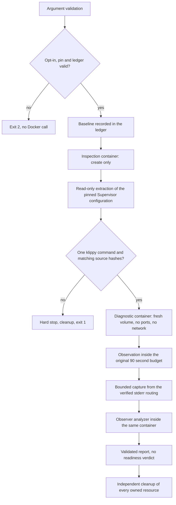

# Simulator identification diagnostic runner

`scripts/simulator-identify-diagnostic.mjs` is a maintained, opt-in, bounded
runner that observes one identification session inside the pinned synthetic
simulator. It exists to answer a question the current collector cannot: what
did the Klipper identification session observe while the serial queue was still
alive.

The runner is an instrument, not a gate. It never reports readiness, never
retries a failed run, never promotes a result to a passing check and never
changes the 90-second readiness budget, the pinned image, the emulator, the
firmware, the Supervisor restart policy or the Compose limits.

The runner reuses `infra/sim/experiments/serial_diagnostic.py` unchanged. The
observer owns the classification; the runner only validates what the observer
produced and refuses to emit anything it cannot verify.

## Status

Source, focused tests and this document are prepared. **No container, network,
serial device or simulator was created by this task**, so no observation result
exists yet. Every statement below describes the implemented behaviour of the
source, not a measurement.

| Property           | Value                                                                                                                    |
| ------------------ | ------------------------------------------------------------------------------------------------------------------------ |
| Pinned image       | `ghcr.io/mainsail-crew/virtual-klipper-printer@sha256:c2ab1d20a3f6d9dda182bf69a078c5f37a066a44f1f34ffea48d49ddf7bbce47`  |
| Platform           | `linux/amd64`                                                                                                            |
| Observer file      | `infra/sim/experiments/serial_diagnostic.py`, SHA-256 `791805817b88d1f365a49a2c968c028026a95d8b6fb500f2956af833e05033fb` |
| Observation window | at most 90 000 ms, the original readiness budget                                                                         |
| Readiness verdict  | always `not-evaluated`                                                                                                   |

## Invocation

```sh
node scripts/simulator-identify-diagnostic.mjs \
  --opt-in=synthetic-identification-diagnostic \
  --ledger-dir=/absolute/path/outside/the/repository
```

| Argument                | Required | Meaning                                                         |
| ----------------------- | -------- | --------------------------------------------------------------- |
| `--opt-in=<token>`      | yes      | must equal `synthetic-identification-diagnostic`                |
| `--ledger-dir=<path>`   | no       | external evidence directory, refused when inside the repository |
| `--image=<reference>`   | no       | must equal the reviewed pinned amd64 reference                  |
| `--platform=<name>`     | no       | must equal `linux/amd64`                                        |
| `--observation-ms=<n>`  | no       | at most 90 000                                                  |
| `--compose-file=<path>` | no       | Compose file whose pin is verified                              |
| `--observer=<path>`     | no       | observer file whose hash is verified                            |

Any other argument is refused. Arguments that name an endpoint, a host, a port,
a URL, a socket, a serial device, a printer or a network are refused before
anything runs. The process exit code is `0` for a completed diagnostic, `2` for
a refused invocation and `1` for a failed run.

The runner writes one JSON object to standard output. On failure it writes one
JSON object to standard error with the primary failure, the phase and the
cleanup failures.

## Safety model



Container constraints, all enforced by `assertContainerIsolation`:

| Constraint            | Value                                                                            |
| --------------------- | -------------------------------------------------------------------------------- |
| Network               | `--network none`, no published port                                              |
| Privileges            | no `--privileged`, no `--device`, `no-new-privileges:true`                       |
| Image                 | `--pull never`, the reviewed pinned digest only                                  |
| CPU, memory, PIDs     | 2 CPUs, 1 GiB, 256 PIDs, as the current Compose service                          |
| Mounts                | the observer and the transformed configuration read-only, one fresh named volume |
| Temporary directories | `/tmp` and `printer_data/comms` with `noexec`                                    |

The runner creates only resources that carry its own label
`com.open3dfarmmanager.identify-diagnostic=<run id>`. A resource is removed
only after its labels are verified. A label mismatch is a refusal, never a
deletion. There is no prune, no broad filter and no process kill.

## Configuration adaptation

The Supervisor configuration is extracted read-only from the pinned image. The
image entrypoint metadata yields the entrypoint script, the script yields the
Supervisor configuration path, and the configuration is copied out of the
inspection container. Nothing is guessed: when the derivation fails, the run
stops and names the missing piece.

The transformation changes exactly one value, the `command` of the
`[program:klipper]` section:

```text
command=python3 /home/printer/klipper/klippy/klippy.py
->
command=python3 /opt/o3dfm/serial_diagnostic.py observe /home/printer/klipper --
```

The rules are strict:

1. Exactly one `[program:klipper]` section and exactly one `command` in it.
2. The interpreter and its flags are preserved verbatim.
3. The Klippy arguments after the script path are preserved verbatim.
4. The Klipper root is derived from the script path, never invented.
5. The restart and retry policy, the priorities and every other program stay
   byte-identical; the transformation re-parses the result and refuses to
   continue when any of them changed.
6. Shell metacharacters, quoting characters and whitespace inside an argument
   are refused. The command is never evaluated as a shell string.

The extracted configuration belongs to the upstream image and stays under its
GPL-3.0 licence. It is written to the external ledger with a notice file and
is never committed.

## Stderr routing

The child's stderr is read from the routing verified in the extracted
configuration, never from an assumption about Docker logs.

| Configuration                                | Capture source                 |
| -------------------------------------------- | ------------------------------ |
| `stderr_logfile` set                         | that file inside the container |
| `redirect_stderr=true` with `stdout_logfile` | the stdout log file            |
| neither                                      | the container output           |

An empty capture is reported as an empty capture. It is not evidence of
silence, and the report keeps the observer record count so that a missing
routing stays visible.

## Output

The report carries validated observer data, process lifecycle metadata and
digests. It never carries raw configuration, raw log lines, serial payloads,
environment values, file paths or process identifiers. The captured child
stderr stays in the external ledger.

```jsonc
{
  "schema": "open3dfarmmanager.simulator-identify-diagnostic.v1",
  "run": "open3dfm-identify-<run id>",
  "image": "ghcr.io/mainsail-crew/virtual-klipper-printer@sha256:...",
  "platform": "linux/amd64",
  "observer": {
    "sourceSha256": "791805...",
    "mountPath": "/opt/o3dfm/serial_diagnostic.py",
  },
  "pin": { "composeSha256": "…", "imageDigest": "sha256:c2ab1d20…" },
  "sources": [{ "file": "klippy/serialhdl.py", "sha256": "72b1a8..." }],
  "configuration": {
    "pathDigest": "…",
    "originalSha256": "…",
    "transformedSha256": "…",
    "delta": {
      "changedProgram": "klipper",
      "changedKey": "command",
      "preserved": { "autorestart": "true", "startretries": "3" },
    },
  },
  "container": {
    "isolation": {
      "network": "none",
      "publishedPorts": 0,
      "privileged": false,
      "devices": 0,
    },
    "state": "running",
    "exitCode": 0,
    "oomKilled": false,
  },
  "observation": {
    "budgetMs": 90000,
    "windowMs": 90000,
    "observedMs": 90000,
    "exceededBudget": false,
  },
  "routing": { "kind": "stderr-file", "pathDigest": "…" },
  "capture": {
    "available": true,
    "reason": "observer-records-captured",
    "bytes": 133,
    "limitBytes": 1048576,
    "observerRecords": 2,
    "truncated": false,
  },
  "wrapperApplied": true,
  "processes": {
    "klipper": "RUNNING",
    "moonraker": "RUNNING",
    "simulavr": "RUNNING",
    "webcamd": "RUNNING",
  },
  "observerAnalysis": { "truncated": false, "sessions": [] },
  "readiness": "not-evaluated",
  "conclusion": "diagnostic-only observation; no readiness acceptance and no retry",
  "cleanup": { "errors": [], "completed": true },
}
```

`capture.reason` states why the capture looks the way it does:
`observer-records-captured`, `no-observer-records` or `capture-unavailable`.
An empty capture is never presented as silence.

`wrapperApplied` reports whether the running Klippy process really carries the
observer wrapper. It is read from the process command line of the Supervisor
program, so a configuration that did not take effect cannot pass silently.

The observer analysis is validated against a closed vocabulary: one
classification per session, finite elapsed times, non-negative counters and
only the known counter names. Unknown fields are dropped before the report is
written.

## Bounds

| Bound              | Value                                   | Source                          |
| ------------------ | --------------------------------------- | ------------------------------- |
| Observation window | 90 000 ms                               | `packages/sim-tools/src/cli.ts` |
| Docker call        | 10 000 ms                               | runner constant                 |
| Captured stderr    | 1 048 576 bytes                         | runner constant                 |
| Observer input     | 16 MiB, 4 097 events, 65 536 byte lines | existing observer               |
| Observer events    | 4 096 plus one truncation record        | existing observer               |

A non-response cannot extend the original 90 seconds. The runner observes
inside that budget and stops.

## Failure semantics

Every phase failure aborts the run and triggers cleanup. The failure keeps the
primary error and lists the cleanup failures next to it, one entry per owned
resource. Cleanup runs once per resource and continues after a failed removal.

| Phase     | Hard stop condition                                                                                                        |
| --------- | -------------------------------------------------------------------------------------------------------------------------- |
| preflight | missing opt-in, foreign image, extended window, ledger inside the repository, observer hash mismatch, Compose pin mismatch |
| baseline  | the inventory cannot be recorded                                                                                           |
| discover  | the configuration path cannot be derived or extracted, a Klipper source hash differs                                       |
| transform | not exactly one klippy command, unsupported interpreter, metacharacters, a changed policy                                  |
| observe   | the container cannot be created or started                                                                                 |
| verify    | the wrapper is not in the running process command line                                                                     |
| capture   | the verified routing cannot be read                                                                                        |
| analyze   | the observer analyzer fails or returns an invalid shape                                                                    |
| cleanup   | a removal fails; the observation is kept and the failure reported                                                          |

## Verification

```sh
node --test tests/node/simulator-identify-diagnostic.test.ts
```

The tests use a fake Docker seam and fake processes. They start no container,
no network, no browser and no printer. They cover the refused opt-in, the
foreign pin, the refused endpoints, the shell injection attempt, the
configuration mismatch, the source hash mismatch, the bounded capture, the
validation of the observer data, the secret redaction, the timeout without a
retry, the independent cleanup, the refusal to remove an unlabelled resource
and the refusal to write the ledger inside the repository.

These checks are source-level. They are not part of `check:all` and they do not
establish simulator acceptance.

## Later CI integration

The runner is a standalone process with one JSON object on standard output and
a meaningful exit code. Wiring it into the failing CI path is a separate
reviewed delta that:

1. keeps the existing required simulator check unchanged and keeps it as the
   gate,
2. runs the runner as an additional step after that check fails,
3. keeps the existing collector untouched,
4. treats the runner output as diagnostic evidence only, never as a pass, and
5. runs the runner with the explicit opt-in and an external ledger directory.

The runner is ready for that seam. The seam itself is not part of this change.

## Gaps

- The Supervisor configuration path and the Klipper checkout path inside the
  image are not recorded in this repository. Both are derived at run time and
  verified. A derivation failure stops the run and names the missing piece.
- The pinned image under the native amd64 CI host is not characterised by this
  task. The runner produces evidence; it does not conclude a cause.
- The historical observations in
  [the serial diagnostic document](SIMULATOR-SERIAL-DIAGNOSTIC.md) remain the
  source of what was seen locally. The observer has run before; nothing here
  claims otherwise.

## Validação manual

Example 1: the pinned command of the image is
`command=python3 /home/printer/klipper/klippy/klippy.py`. The transformed
command is
`command=python3 /opt/o3dfm/serial_diagnostic.py observe /home/printer/klipper --`.
The derived Klipper root is `/home/printer/klipper`. The observer receives the
root, so it imports `<root>/klippy/serialhdl.py` and runs
`<root>/klippy/klippy.py` with no argument, exactly as the original command
intended.

Example 2: the pinned command is
`command=/usr/bin/python3 -u /home/printer/klipper/klippy/klippy.py -I`. The
transformed command is
`command=/usr/bin/python3 -u /opt/o3dfm/serial_diagnostic.py observe /home/printer/klipper -- -I`.
The interpreter, its flag and the Klippy argument survive unchanged.

Example 3: the extracted configuration contains two `[program:klipper]`
sections. The transformation refuses with
`expected exactly one [program:klipper] section, found 2`, no diagnostic
container is started and the inspection container is removed. The runner exits
with code 1.

Example 4: the captured child stderr holds 2 lines that start with
`O3DFM_SERIAL_DIAGNOSTIC ` and 133 bytes in total. The report shows
`capture.observerRecords: 2`, `capture.bytes: 133`,
`capture.truncated: false` and the observer analysis of those two records.

Example 5: the captured child stderr holds 1 048 576 bytes or more. The report
shows `capture.bytes: 1048576` and `capture.truncated: true`. The capture is
never larger than the limit and the observation window stays inside 90 000 ms.

Example 6: the removal of the diagnostic container fails while the volume
removal succeeds. The run reports `cleanup.completed: false` with one cleanup
error for the container, and the volume removal was still attempted.
