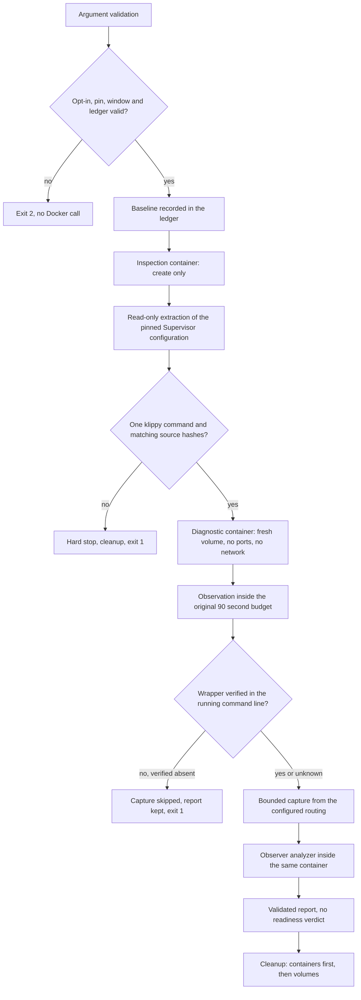

# Simulator identification diagnostic runner

`scripts/simulator-identify-diagnostic.mjs` is a maintained, opt-in, bounded
runner that observes one identification session inside the pinned synthetic
simulator. It exists to answer a question the current collector cannot: what
did the Klipper identification session observe while the serial queue was still
alive.

The runner is an instrument, not a gate. It never reports readiness, never
retries a failed run, never promotes a result to a passing check and never
changes the 90-second readiness budget, the pinned image, the emulator, the
firmware, the Supervisor restart policy or the Compose limits.

The runner reuses `infra/sim/experiments/serial_diagnostic.py` unchanged. The
observer owns the classification; the runner only validates what the observer
produced and refuses to emit anything it cannot verify.

## Status

Source, focused tests and this document are prepared. **No container, network,
serial device or simulator was created by this task**, so no observation result
exists yet. Every statement below describes the implemented behaviour of the
source, not a measurement.

| Property           | Value                                                                                                                    |
| ------------------ | ------------------------------------------------------------------------------------------------------------------------ |
| Pinned image       | `ghcr.io/mainsail-crew/virtual-klipper-printer@sha256:c2ab1d20a3f6d9dda182bf69a078c5f37a066a44f1f34ffea48d49ddf7bbce47`  |
| Platform           | `linux/amd64`                                                                                                            |
| Observer file      | `infra/sim/experiments/serial_diagnostic.py`, SHA-256 `791805817b88d1f365a49a2c968c028026a95d8b6fb500f2956af833e05033fb` |
| Observation window | at most 90 000 ms, the original readiness budget                                                                         |
| Readiness verdict  | always `not-evaluated`                                                                                                   |

The Docker binary is resolved from `PATH` as `docker`. The runner never
installs anything and never resolves a binary from a repository path, so a
host whose `PATH` points at another `docker` executes that binary. The
programmatic seam accepts a different binary name for a controlled harness.

## Invocation

```sh
node scripts/simulator-identify-diagnostic.mjs \
  --opt-in=synthetic-identification-diagnostic \
  --ledger-dir=/absolute/path/outside/the/repository
```

| Argument                | Required | Meaning                                                    |
| ----------------------- | -------- | ---------------------------------------------------------- |
| `--opt-in=<token>`      | yes      | must equal `synthetic-identification-diagnostic`           |
| `--ledger-dir=<path>`   | no       | external evidence directory, refused inside the repository |
| `--image=<reference>`   | no       | must equal the reviewed pinned amd64 reference             |
| `--platform=<name>`     | no       | must equal `linux/amd64`                                   |
| `--observation-ms=<n>`  | no       | at most 90 000                                             |
| `--compose-file=<path>` | no       | Compose file whose pin is verified                         |
| `--observer=<path>`     | no       | observer file whose hash is verified                       |

Any other argument is refused. Arguments that name an endpoint, a host, a port,
a URL, a socket, a serial device, a printer or a network are refused before
anything runs. The process exit code is `0` for a completed diagnostic, `2` for
a refused invocation and `1` for a failed run.

The image, the platform and the observation window are validated in one place,
`assertRunSettings`, and both the command line and the programmatic entry point
call it. A programmatic caller cannot create a container from an unpinned image
or observe longer than the readiness budget.

The runner writes one JSON object to standard output. A failed run writes the
report it managed to build to standard output first and then one JSON object
to standard error with the primary failure, the phase and the cleanup
failures.

## Safety model



Container constraints, all enforced by `assertContainerIsolation`:

| Constraint            | Value                                                                            |
| --------------------- | -------------------------------------------------------------------------------- |
| Network               | `--network none`, no published port                                              |
| Privileges            | no `--privileged`, no `--device`, `no-new-privileges:true`                       |
| Image                 | `--pull never`, the reviewed pinned digest only                                  |
| CPU, memory, PIDs     | 2 CPUs, 1 GiB, 256 PIDs, as the current Compose service                          |
| Mounts                | the observer and the transformed configuration read-only, one fresh named volume |
| Temporary directories | `/tmp` and `printer_data/comms` with `noexec`                                    |

The forbidden options are refused in every spelling the runner could produce,
including the `--option=value` form, so a regression cannot widen the
isolation by changing the spelling of an argument.

The runner creates only resources that carry its own label
`com.open3dfarmmanager.identify-diagnostic=<run id>`. A resource is removed
only after its labels are verified. A label mismatch is a refusal, never a
deletion. There is no prune, no broad filter and no process kill.

Cleanup removes the containers before the volumes. A volume that is still
mounted by a container cannot be removed, so the reverse order leaks a named
volume on every run. A removal that fails is retried once, and the resources
that were already removed are never inspected again.

## Configuration adaptation

The Supervisor configuration is extracted read-only from the pinned image. The
image entrypoint metadata yields the entrypoint candidates, the first candidate
that is a readable text file yields the entrypoint script, the script yields
the Supervisor configuration path, and the configuration is copied out of the
inspection container. Nothing is guessed: a candidate that is missing, binary
or larger than the permitted size is rejected and the discovery continues with
the next candidate, and a run that finds no usable candidate stops and names
every rejected candidate.

The transformation changes exactly one value, the `command` of the
`[program:klipper]` section:

```text
command=python3 /home/printer/klipper/klippy/klippy.py
->
command=python3 /opt/o3dfm/serial_diagnostic.py observe /home/printer/klipper --
```

The rules are strict:

1. Exactly one `[program:klipper]` section and exactly one `command` in it.
2. The interpreter and its flags are preserved verbatim.
3. The Klippy arguments after the script path are preserved verbatim.
4. The Klipper root is derived from the script path, never invented.
5. The restart and retry policy, the priorities and every other program stay
   byte-identical; the transformation re-parses the result and refuses to
   continue when any of them changed.
6. Shell metacharacters, quoting characters and whitespace inside an argument
   are refused. The command is never evaluated as a shell string.

The extracted configuration belongs to the upstream image and stays under its
GPL-3.0 licence. It is written to the external ledger with a notice file and
is never committed.

## Child stderr routing

The observer writes to the child's stderr. Where that stderr lands is decided
by Supervisor, and the runner derives the answer from the extracted
configuration instead of assuming it.

| Configuration                                    | Capture source                               |
| ------------------------------------------------ | -------------------------------------------- |
| `redirect_stderr=true` with `stdout_logfile`     | that file inside the container               |
| `redirect_stderr=true` without `stdout_logfile`  | the Supervisor child log under `childlogdir` |
| `redirect_stderr=false` with `stderr_logfile`    | that file inside the container               |
| `redirect_stderr=false` without `stderr_logfile` | the container output                         |
| `redirect_stderr` absent                         | both branches stay possible                  |

The last row matters. When the directive is absent, Supervisor's own default
decides between the two branches, and the runner does not guess it. Both
routes that the configuration permits are read, and the route that actually
carries the observer records is the proof. The report then separates the two
facts:

| Field               | Meaning                                                      |
| ------------------- | ------------------------------------------------------------ |
| `routing.kind`      | the route the configuration describes                        |
| `routing.ambiguous` | the directive is absent and more than one route was possible |
| `routing.evidence`  | `observer-records` when a route carried records, else `none` |
| `capture.source`    | the route the capture was actually read from                 |

The child log branch never assumes a file name. The runner resolves the child
log directory from the `childlogdir` directive of the `[supervisord]` section,
or from the `TMPDIR` of the running container, and then lists that directory
in a bounded way and reads the files it finds. The route is accepted when the
file carries observer records, not when it matches a guessed name.

An unusable routing is a reported condition, not an abort. The report carries
`routing.kind: unresolved` and `capture.reason: routing-unresolved`, and the
observation is kept.

An empty capture is reported as an empty capture. It is not evidence of
silence, and the report keeps the observer record count so that a missing
routing stays visible.

## Output

The report carries validated observer data, process lifecycle metadata and
digests. It never carries raw configuration, raw log lines, serial payloads or
environment values. The captured child stderr stays in the external ledger.

The report does carry two kinds of path. The `ledger` field is the external
evidence directory, which is outside the repository by construction, and the
configuration delta and the source list carry container-internal paths such as
the Klipper root and the observer mount path. Neither is a host path of the
private configuration, and neither is a secret.

```jsonc
{
  "schema": "open3dfarmmanager.simulator-identify-diagnostic.v1",
  "run": "open3dfm-identify-<run id>",
  "image": "ghcr.io/mainsail-crew/virtual-klipper-printer@sha256:...",
  "platform": "linux/amd64",
  "observer": {
    "sourceSha256": "791805...",
    "mountPath": "/opt/o3dfm/serial_diagnostic.py",
  },
  "pin": { "composeSha256": "…", "imageDigest": "sha256:c2ab1d20…" },
  "sources": [{ "file": "klippy/serialhdl.py", "sha256": "72b1a8..." }],
  "configuration": {
    "pathDigest": "…",
    "originalSha256": "…",
    "transformedSha256": "…",
    "delta": {
      "changedProgram": "klipper",
      "changedKey": "command",
      "preserved": { "autorestart": "true", "startretries": "3" },
    },
  },
  "container": {
    "isolation": {
      "network": "none",
      "publishedPorts": 0,
      "privileged": false,
      "devices": 0,
    },
    "state": "running",
    "exitCode": 0,
    "oomKilled": false,
  },
  "baseline": { "recorded": true, "failures": [] },
  "observation": {
    "budgetMs": 90000,
    "windowMs": 90000,
    "observedMs": 90000,
    "exceededBudget": false,
  },
  "routing": {
    "kind": "stderr-file",
    "pathDigest": "…",
    "evidence": "observer-records",
    "ambiguous": false,
  },
  "capture": {
    "available": true,
    "reason": "observer-records-captured",
    "bytes": 133,
    "limitBytes": 1048576,
    "observerRecords": 2,
    "invalidRecords": 0,
    "truncated": false,
    "source": "stderr-file",
  },
  "supervisorObservation": "observed",
  "wrapperApplied": true,
  "wrapperReason": "observer-in-command",
  "processes": {
    "klipper": "RUNNING",
    "moonraker": "RUNNING",
    "simulavr": "RUNNING",
    "webcamd": "RUNNING",
  },
  "observerAnalysis": { "truncated": false, "sessions": [] },
  "readiness": "not-evaluated",
  "conclusion": "diagnostic-only observation; no readiness acceptance and no retry",
  "cleanup": { "errors": [], "completed": true },
  "stages": { "preflight": 12, "observe": 90001, "cleanup": 40 },
  "totalElapsedMs": 91200,
}
```

`capture.reason` states why the capture looks the way it does:
`observer-records-captured`, `no-observer-records`, `capture-unavailable`,
`routing-unresolved` or `wrapper-not-applied`. An empty capture is never
presented as silence.

`supervisorObservation` and `wrapperApplied` keep three different facts apart.
A Supervisor that cannot be read is `unavailable`, not an empty map, and it is
not a statement about the wrapper:

| `wrapperApplied` | `wrapperReason`                | What it means                                          |
| ---------------- | ------------------------------ | ------------------------------------------------------ |
| `true`           | `observer-in-command`          | the running process carries the observer wrapper       |
| `false`          | `observer-absent-from-command` | the transformation provably did not reach the process  |
| `unavailable`    | `supervisor-unavailable`       | Supervisor could not be read at all                    |
| `unavailable`    | `program-not-running`          | the Klippy program has no process, for example `FATAL` |
| `unavailable`    | `command-unreadable`           | the process exists but its command line is unreadable  |

Only a verified absence is a failure. An unreadable observation never becomes
a false wrapper failure and never stops the run.

A verified absence does stop the run, because a capture taken without the
wrapper proves nothing. The capture is skipped, the report is written to the
ledger and to standard output, and the exit code is `1`.

The observer analysis is validated against a closed vocabulary: one
classification per session, finite elapsed times, non-negative counters and
only the known counter names. Unknown fields are dropped before the report is
written.

The observer aborts on the first record that does not parse, which would turn
a half written record into no analysis at all. The runner therefore hands the
analyzer only the observer records it can read and reports how many it
dropped in `capture.invalidRecords`. The observer still owns every
classification.

## Bounds

| Bound              | Value                                   | Source                          |
| ------------------ | --------------------------------------- | ------------------------------- |
| Observation window | 90 000 ms                               | `packages/sim-tools/src/cli.ts` |
| Docker call        | 10 000 ms                               | runner constant                 |
| Captured stderr    | 1 048 576 bytes                         | runner constant                 |
| Observer input     | 16 MiB, 4 097 events, 65 536 byte lines | existing observer               |
| Observer events    | 4 096 plus one truncation record        | existing observer               |

The observation window is a bound on the observation phase. Each polling call
receives the time that is left as its own timeout, so a Docker call that does
not answer cannot push the phase past the deadline. The run as a whole has no
fixed deadline: the baseline, the discovery, the creation, the capture, the
analysis and the cleanup are bounded per call. The report carries the elapsed
time of every stage in `stages` and the elapsed time of the whole run in
`totalElapsedMs`, so the cost of a run is visible.

## Failure semantics

A phase that cannot produce the evidence it promises stops the run and
triggers the cleanup. A condition that only weakens the evidence is reported
and the run continues, because the observation is still worth keeping.

| Phase     | Stops the run                                                                                                                                   | Only reported                                           |
| --------- | ----------------------------------------------------------------------------------------------------------------------------------------------- | ------------------------------------------------------- |
| preflight | missing opt-in, foreign image, extended window, ledger inside the repository or a linked worktree, observer hash mismatch, Compose pin mismatch | a failed inventory call in the baseline                 |
| baseline  |                                                                                                                                                 | a failed inventory call, with its exit status           |
| discover  | the configuration path cannot be derived or extracted, no usable entrypoint candidate, a Klipper source hash differs                            |                                                         |
| transform | not exactly one klippy command, unsupported interpreter, metacharacters, a changed policy                                                       |                                                         |
| observe   | the container cannot be created or started, a Docker call times out                                                                             |                                                         |
| verify    | the wrapper is verified absent from the running process command line                                                                            | an unreadable Supervisor or process command line        |
| capture   |                                                                                                                                                 | an unusable routing or an unreadable capture source     |
| analyze   |                                                                                                                                                 | a failing analyzer, recorded as `observerAnalysisError` |
| cleanup   | a removal still fails after the retry                                                                                                           |                                                         |

The failure keeps the primary error and lists the cleanup failures next to
it, one entry per owned resource. Cleanup continues after a failed removal.

## Ledger isolation

The evidence directory never lives inside the repository. The refusal covers
the current worktree, the shared git directory and every linked worktree of
the same repository, and it resolves both sides, so a symlink cannot smuggle
the ledger inside a checkout. The refusal happens before anything is created,
so a rejected path leaves no directory behind.

## Verification

```sh
node --test tests/node/simulator-identify-diagnostic.test.ts
```

The tests use a fake Docker seam and fake processes. They start no container,
no network, no browser and no printer. The fake reproduces the Docker
behaviour that matters: a volume that is still mounted by a container refuses
to be removed, and the fake analyzer is a port of the existing observer, so a
capture that the observer would refuse really does fail the run.

The suite covers the refused opt-in, the foreign pin, the refused endpoints,
the programmatic bypass of the settings check, the shell injection attempt,
the configuration mismatch, the source hash mismatch, the removal order, the
volume that is in use, the cleanup retry, the refusal to remove an unlabelled
resource, the bounded capture, the truncation inside an observer record, the
child log routing, the unusable routing, the unavailable Supervisor, the
program that is not running, the verified wrapper failure, the timeout without
a retry, the observation window, the entrypoint candidate fallback, the
secret redaction, the validation of the observer data and the ledger refusal
for the repository, for a linked worktree and through a symlink.

This test file is part of `check:all`: `test:node` runs the
`tests/node/*.test.ts` glob and `typecheck` covers `tests/**/*.ts`. The Python
observer tests stay outside `check:all`, exactly as the historical document
states. The root gate has not been run against this head.

## Divergence from the historical observations

The two observations in
[the serial diagnostic document](SIMULATOR-SERIAL-DIAGNOSTIC.md) disabled the
Klippy restart and retry policy to match the previous diagnostic controls.
This runner preserves the image's own `autorestart` and `startretries`, because
changing them would change the behaviour under observation. A new observation
is therefore **not comparable** with the two historical observations, and the
difference is a deliberate choice of this instrument.

The historical document also records that the pinned image's Supervisor
routing was never established by the collector: an external diagnosis suggests
the container output, while another reading assumed a Supervisor child log.
This runner does not settle that question by reading. It derives the routing
from the extracted configuration at run time and reports which route actually
carried the records.

## Later CI integration

The runner is a standalone process with one JSON object on standard output and
a meaningful exit code. Wiring it into the failing CI path is a separate
reviewed delta that:

1. keeps the existing required simulator check unchanged and keeps it as the
   gate,
2. runs the runner as an additional step after that check fails,
3. keeps the existing collector untouched,
4. treats the runner output as diagnostic evidence only, never as a pass, and
5. runs the runner with the explicit opt-in and an external ledger directory.

The runner is ready for that seam. The seam itself is not part of this change.

## Gaps

- The Supervisor configuration path and the Klipper checkout path inside the
  image are not recorded in this repository. Both are derived at run time and
  verified. A derivation failure stops the run and names the missing piece.
- The pinned image under the native amd64 CI host is not characterised by this
  task. The runner produces evidence; it does not conclude a cause.
- Whether `supervisorctl` works inside the image is unknown. When it does not,
  the report says `supervisorObservation: unavailable` and the wrapper stays
  undecided.
- The child log file name is not known in advance. The runner finds the file
  by content, inside a bounded number of candidates, and reports the route it
  used.
- The historical observations in
  [the serial diagnostic document](SIMULATOR-SERIAL-DIAGNOSTIC.md) remain the
  source of what was seen locally. The observer has run before; nothing here
  claims otherwise.

## Validação manual

Example 1: the pinned command of the image is
`command=python3 /home/printer/klipper/klippy/klippy.py`. The transformed
command is
`command=python3 /opt/o3dfm/serial_diagnostic.py observe /home/printer/klipper --`.
The derived Klipper root is `/home/printer/klipper`. The observer receives the
root, so it imports `<root>/klippy/serialhdl.py` and runs
`<root>/klippy/klippy.py` with no argument, exactly as the original command
intended.

Example 2: the pinned command is
`command=/usr/bin/python3 -u /home/printer/klipper/klippy/klippy.py -I`. The
transformed command is
`command=/usr/bin/python3 -u /opt/o3dfm/serial_diagnostic.py observe /home/printer/klipper -- -I`.
The interpreter, its flag and the Klippy argument survive unchanged.

Example 3: the extracted configuration contains two `[program:klipper]`
sections. The transformation refuses with
`expected exactly one [program:klipper] section, found 2`, no diagnostic
container is started and the inspection container is removed. The runner exits
with code 1.

Example 4: the captured child stderr holds 2 records that start with
`O3DFM_SERIAL_DIAGNOSTIC ` and 133 bytes in total. The report shows
`capture.observerRecords: 2`, `capture.bytes: 133`,
`capture.truncated: false`, `capture.invalidRecords: 0` and the observer
analysis of those two records.

Example 5: the captured child stderr holds 1 048 576 bytes or more. The report
shows `capture.truncated: true` and a `capture.bytes` that never exceeds
`capture.limitBytes: 1048576`. The capture bound removes a half written last
line, so `capture.bytes` can be a little smaller than the limit.

Example 6: the captured child stderr ends inside an observer record. The
unchanged observer refuses that stream with exit code 78. The runner drops the
records it cannot read, reports `capture.invalidRecords: 1` and keeps the
analysis of the remaining records.

Example 7: the removal of the diagnostic container fails while the volume
removal succeeds. The report shows `cleanup.completed: false` with one cleanup
error for the container, and the volume removal was still attempted. When the
container cannot be removed, the volume stays mounted, so the volume removal
fails too and the report shows two cleanup errors.

Example 8: `supervisorctl status` fails inside the container. The report shows
`supervisorObservation: unavailable`, `processes: "unavailable"` and
`wrapperApplied: "unavailable"` with `wrapperReason: supervisor-unavailable`.
The run continues and reports no readiness verdict.

Example 9: the Supervisor reports `klipper FATAL` with no process. The report
shows `processes.klipper: "FATAL"`, `wrapperApplied: "unavailable"` and
`wrapperReason: program-not-running`. The run continues.

Example 10: the running Klippy command line does not carry the observer. The
runner skips the capture, writes `capture.reason: wrapper-not-applied`,
`wrapperApplied: false` and `wrapperReason: observer-absent-from-command`,
keeps the report in the ledger and on standard output and exits with code 1.

Example 11: the ledger directory is inside the repository, inside a linked
worktree or reaches the repository through a symlink. The run refuses before
any Docker call, creates no directory and exits with code 1.

Example 12: a programmatic caller passes an unpinned image or an observation
window above 90 000 ms. The run refuses with the phase `settings` before any
Docker call.
