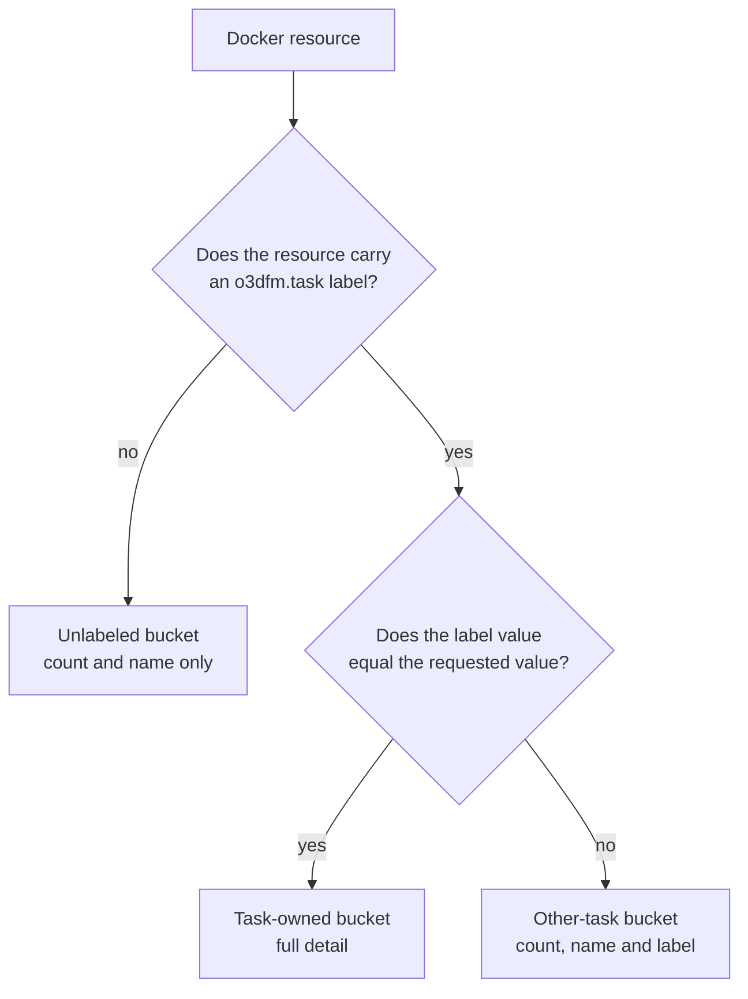
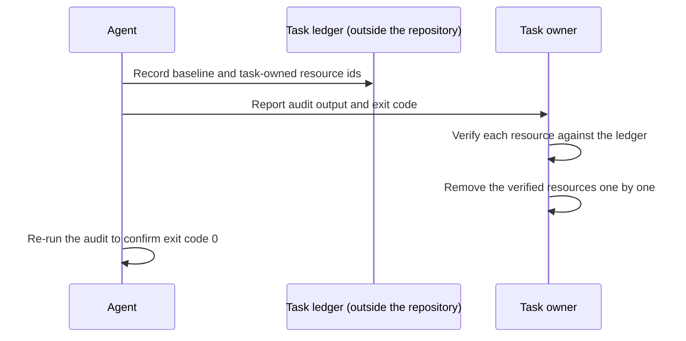

# Task resource audit

Status: em revisão. Lens owner: coordinator.

`scripts/audit-task-resources.ts` reports the resources that a single development task left on the machine: free disk space, Git worktrees with their working tree state, and the Docker containers, volumes and networks that carry the task's own label. The tool is read-only. It never creates, starts, stops, removes or prunes anything.

The task label is the value of the `o3dfm.task` Docker label. A resource counts as owned only when that label value matches the requested one exactly. Names never imply ownership, so a container named `o3dfm-task-alpha-pg` belongs to the task only if its `o3dfm.task` label says so.

## Running the audit

The task label is a required argument. There is no default and no inference from the current branch or directory.

```sh
bun scripts/audit-task-resources.ts --task-label <value>
bun scripts/audit-task-resources.ts --task-label <value> --pretty
bun scripts/audit-task-resources.ts --task-label <value> --repo <path>
```

The report is a single JSON object on stdout. Errors go to stderr.

| Option                 | Meaning                                                                |
| ---------------------- | ---------------------------------------------------------------------- |
| `--task-label <value>` | Required. The exact `o3dfm.task` label value to audit.                 |
| `--repo <path>`        | Repository to audit. Defaults to the repository containing the script. |
| `--pretty`             | Indent the JSON output.                                                |
| `-h`, `--help`         | Print usage and exit 0.                                                |

## Ownership model

Each Docker resource lands in one of three buckets.

| Bucket     | Condition                                     | Reported as                                                                |
| ---------- | --------------------------------------------- | -------------------------------------------------------------------------- |
| Task-owned | `o3dfm.task` label equals the requested value | Full detail: kind, id, name, state, image, platform, creation time, driver |
| Other task | `o3dfm.task` label is present and differs     | Count plus name and label only                                             |
| Unlabeled  | No `o3dfm.task` label                         | Count plus name only                                                       |

The distinction between the last two buckets matters for cleanup. Both are outside the audited task, and the report keeps them out of the owned list so nobody removes them by mistake. Names are enough to identify them; the image, state and creation time of another project's resources stay out of the report.

Ownership is decided by literal string equality after the label is read from Docker. A prefix, a suffix, a different case or a substring in the resource name all resolve to "not owned".



## Exit codes

| Code | Meaning                                                  |
| ---- | -------------------------------------------------------- |
| 0    | Complete report. No task-owned resource is present.      |
| 1    | Usage error. The task label is missing or invalid.       |
| 2    | Partial report. At least one section was unavailable.    |
| 3    | Complete report. Task-owned resources are still present. |

Exit code 2 is the important one for automation. When the Docker daemon is unreachable, the tool still prints the disk and Git sections it managed to collect, marks the Docker section `unavailable` with the reason, and exits 2. An empty Docker list never gets reported as a clean result.

## Reporting a task-owned resource

The audit answers whether resources remain. Removing them is a separate, deliberate step that a person performs after checking each one.



## The task ledger

AGENTS.md asks for a task ledger outside the repository. The audit does not create or read one, because a ledger holds host paths and resource identifiers that should not be committed.

Keep the ledger in a directory outside the working tree, for example under the user's private state directory:

```sh
mkdir -p "$HOME/.local/state/o3dfm/ledgers"
$EDITOR "$HOME/.local/state/o3dfm/ledgers/<task-label>.md"
```

One ledger file per task label. Record:

- The baseline taken before the task started: worktree list, `git status` output, and the Docker container, volume and network inventories.
- Every resource the task created, with its exact id.
- The audit output and exit code from each run.
- What was removed, when it was removed, and what was kept.

Resource ids and host paths belong in the ledger and not in a committed report. A committed summary can carry the task label and the counts, and those are what the cleanup record in the task notes needs.

## Manual verified cleanup

Cleanup stays manual on purpose. Each step below needs a person to confirm the target before it is removed.

1. Run the audit and read the `docker.owned` bucket. Every entry there carries the task label, so each one is a candidate.
2. Match the entries against the ledger. Anything missing from the ledger was not created by this task, so leave it alone and record why.
3. Check that no other task depends on the resource. A shared image, a shared volume and a running container that another branch uses all count as dependencies.
4. Remove the resources one at a time, starting with containers. Confirm the removal succeeded before moving to the next.
5. Remove the task's volumes and networks after their containers are gone.
6. Remove a pulled image only when the baseline proves the task introduced it and no other task needs it.
7. Re-run the audit. Exit code 0 with an empty `docker.owned` bucket confirms the task left nothing behind.

Do not use a broad prune. A global prune removes resources that belong to other projects, and the machine usually hosts work that this repository never created. Never remove a worktree whose commits are not merged or otherwise preserved, and never discard uncommitted changes.

## Worktree handling

The Git section reports every worktree of the repository with its branch, head commit and a working tree summary: staged, modified, untracked, renamed and conflicted counts, plus a short sample of the changed paths.

A dirty worktree holds work that no other branch has. Confirm that its commits are merged into the intended target and that its uncommitted changes are either committed or intentionally discarded before removing it. The audit reports the state, and the removal decision belongs to the owner.

## Limits

- The audit reads the host it runs on. It reports the Docker daemon of the current context.
- Ownership depends on the `o3dfm.task` label. A resource created without that label is unlabeled no matter which task started it, so the label has to be set at creation time.
- The tool lists at most 5000 resources per Docker kind and reports at most 200 owned entries and 10 sample entries per bucket. A `truncated` flag marks a bucket that hit the limit.
- Every command runs with a 15 second timeout and a bounded output buffer, so a hung daemon cannot stall the audit.
- The Git status of a very large repository can be slow. The timeout applies there too.
- The report is a snapshot. Resources created or removed during the run may be missing or stale.

## Validation

Run these against a scratch environment with no task-owned resources, then again against a label that owns something.

1. Missing label. `bun scripts/audit-task-resources.ts` prints the usage error on stderr and exits 1.

   ```sh
   bun scripts/audit-task-resources.ts >/dev/null 2>&1; echo $?
   # 1
   ```

2. Empty label. `--task-label ""` exits 1 with `Task label value must not be empty`.

3. Label with surrounding spaces. `--task-label " alpha "` exits 1, because the value would never match a Docker label.

4. Label of a task that owns nothing. The report has `status` `complete`, `docker.owned.<kind>.count` of 0 for all three kinds, and exit code 0.

5. Label of a task that owns a container, a volume and a network. Each matching kind has `count` of 1, and `docker.owned.container.items[0].taskLabel` equals the requested value exactly. Exit code is 3.
6. Partial name. Requesting label `alpha` against a resource labelled `alpha-extra` leaves `docker.owned` empty and places the resource in `docker.otherTask`. Its count rises by one, and `docker.owned` stays at zero for every kind.

7. Docker unavailable. With `docker` absent from `PATH`, the report has `docker.status` of `unavailable`, `docker.reason` mentioning the daemon, `status` of `partial`, and exit code 2. The Git and filesystem sections stay populated.

8. Read-only guarantee. The audit leaves the Docker inventory unchanged. Capture the container, volume and network lists before and after a run, then confirm the three pairs match.

9. Non-owned details withheld. A resource in `docker.unlabeled` reports only `kind`, `id`, `name` and `taskLabel`. Its image and state never appear in the report.
